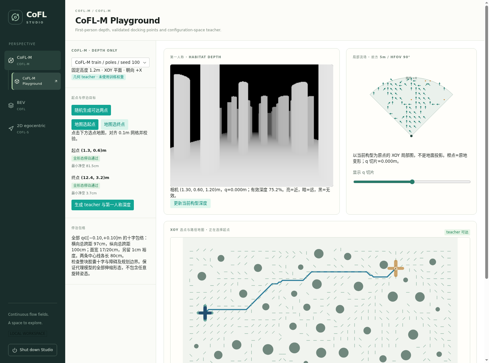

# cof-m Studio 与 CoFL-S 原流程教程

名称统一为 `cof-m`；已有 API/配置标识及 `artifacts/cofl-m/`、`.habitat/coflm` 路径继续兼容，下面的命令可直接使用现有产物。

2026-11-15：Studio 已新增独立的 **cof-m → cof-m Playground**。此前的 BEV GLB 预览只展示了几何，没有接入 cof-m teacher，也不符合第一人称、无语言任务的操作方式。现在使用此新入口。

## 1. 启动和打开

从仓库根目录运行：

```bash
.venv/bin/python -m cofl app \
  --config artifacts/cofl-m/habitat-train-preview/studio.yaml \
  --no-browser --port 8788
```

然后打开 <http://127.0.0.1:8788>，选择 **cof-m → cof-m Playground**。如果浏览器仍显示旧版本，先按 **Ctrl+Shift+R** 强制刷新。

`--no-browser` 表示“不自动打开浏览器”，不会关闭浏览器或禁用网页；需要自动弹出页面时，删掉这个参数即可。`--port 8788` 指定服务端口，浏览器地址也要使用 `8788`；不指定时默认是 `8787`。终端显示 `Uvicorn running on http://127.0.0.1:8788` 才表示服务已开始监听。

若看到 **Renderer not installed**，同时右上角仍有 **Load policy**，说明页面运行的前端没有安装新版 cof-m 界面。菜单来自后端，正文来自前端，所以旧 JS 配新后端会出现“有入口、无正文”。本地构建已有该界面时，可在服务启动后打开 <http://127.0.0.1:8788/?studio_reload=20261115> 绕过旧首页缓存，或使用无痕窗口。新版服务器已对首页设置 `Cache-Control: no-store`，并避免首页返回旧的 304 缓存；修改后重启服务生效。若换全新窗口仍出现同样错误，再按下文用 `--build` 重建前端。

### 正确退出和再次打开

- **只关闭浏览器标签页/窗口**：服务继续运行。下次直接打开同一个地址，不需要再次运行启动命令。
- **在启动服务的终端按一次 Ctrl+C**：等待 `Application shutdown complete`、`Finished server process`，以及终端重新出现命令提示符，再运行启动命令。浏览器中的 Ctrl+C 不是停止服务。
- **点击左下角 Shut down Studio**：等待清理和服务退出；以后重新运行启动命令，再刷新浏览器页面。旧标签页可能仍显示 `Studio closed`，它不会因为后端重新启动而自动恢复。

有 teacher 计算或 Habitat 采集正在进行时，退出会等待当前请求完成。不要在旧服务尚未退出时重复启动。

如果提示端口占用（`address already in use`），在另一个终端检查：

```bash
ss -ltnp 'sport = :8788'
```

先尝试打开原页面并点击 **Shut down Studio**，或回到原启动终端按 Ctrl+C。原终端找不到时，先用 `ps -p <PID> -o pid,args` 确认占用者确实是这个 Studio，再用 `kill -TERM <PID>` 请求退出；将 `<PID>` 替换成上一步看到的数字。无需重启电脑或杀掉所有 Python/浏览器进程。

前端源码有修改时需先重新构建：

```bash
.venv/bin/python -m cofl app \
  --config artifacts/cofl-m/habitat-train-preview/studio.yaml \
  --build --no-browser --port 8788
```

构建要求 Node.js 20.19+ 或 22.12+。当前前端资源已经构建好，日常运行不用 `--build`。本次临时构建使用 `/tmp/node-v22.14.0-linux-x64/bin`，无需将其当作永久环境路径。

如果出现 `Building Studio requires the CoFL source checkout and Node.js/npm`，表示这次命令要求重新构建，但源码构建文件或当前终端 PATH 中的 npm 不可用，服务尚未启动。已有前端资源时去掉 `--build`，用本节最开始的命令启动即可；这个错误与上次如何关闭浏览器或服务无关。

场景集不存在时先生成：

```bash
.venv/bin/python -m cofl.experiments.habitat_scene_set \
  --output artifacts/cofl-m/habitat-train-preview \
  --habitat-python .habitat/coflm/bin/python
```

现有 6 场景、96 帧集无需重复生成；非空输出目录不会被覆盖。

## 2. 新 cof-m 页面怎么用

1. 选择场景。页面自动随机生成一对有效且在 teacher 图中连通的停泊点，并计算 teacher、采集起点深度。
2. 左上为 **Habitat 第一人称深度**，使用真实模拟器在选中位置重新采集，非 RGB、非假深度。亮表示近，暗表示远，黑为无效。相机固定 z=1.2m、朝规划 +X。
3. 右上为 **前方 5m、90° 的局部流场图**。它是以当前构型为原点的水平面示意，不是投影到地板上的标签。用 q 滑条查看不同形态切片；橙点表示原地变形动作。
4. 下方 **XOY 选点与路径地图** 显示障碍、S/G、停泊包络、场切片和 teacher 路径。它用于指定坐标，第一人称观测仍由上方深度窗口承担。
5. **随机生成可达两点** 会重新采样、校验和求解。随机点先满足全形态停泊，再要求起终点 q=0 在当前构型图中连通，且距离至少 3m；为便于默认 +X 相机观察，按 x 坐标排列起终点。不是全空间均匀任务采样器。
6. 自选时，先点击 **地图选起点** 或 **地图选终点**，再点地图。选点明确对齐 0.1m 网格。无效点显示红色并给出原因，旧 teacher 立即清除；不会自动挪到旁边的空位。选好两个有效点后点击 **生成 teacher 与第一人称深度**。
7. 浏览路径滑条时，地图中的机体构型和 q 会变化。点击 **更新当前构型深度** 才重新采集该位置的观测；旧图若仍属于前一位置，页面会明确提示。没有运行无人机动力学或自动驾驶。
8. 使用 **下载当前 teacher.npz** 获取标签。页面没有语言指令、旧模型加载控件；目前显示几何 teacher，没有声称使用训练好的 DFormer 预测。



## 3. 停泊点到底检查什么

机体横纵外轮廓初始各长 80cm，面宽恒定 20cm。以米为单位，`Lx=0.80+2q`、`Ly=0.80−2q`，`q∈[−0.10,+0.10]m`。横纵各在 60–100cm 内变化，总长恒为 160cm，关于机体中心对称伸缩。

胶囊代理的中心线不含两端各 10cm 的圆帽，因此中心线长度为 `0.60±2q` 米。全部形态的停泊并集横纵各跨 100cm；这不是某个实际构型同时达到 100×100cm。碰撞额外保留 1cm 裕度。圆端胶囊仍是代理外形。

这里的“任意形态”指**当前代理在固定 yaw=0 下的全部伸缩 q**。不包括任意旋转姿态、倾转旋翼或尚未建模的附件；CAD 和实际硬件包络尚需进一步确认。固定高度也不自动要求固定 yaw，但本次 teacher 原型仍明确固定 yaw。

两种检查分别报告：

- **停泊可行**：起终点分别容纳全部 q 的机体，允许原地变形。
- **路径可达**：两个端点 q=0 之间在 `(x,y,q)` 图中存在路径，路径上逐边检查整机扫掠。自选点即使各自停泊有效，路径仍可能不可达；这时不给出伪路径，也不把不可达当作 STOP。

## 4. Teacher 在哪里

每次点击计算会保存到：

```text
artifacts/cofl-m/studio-tasks/<页面显示的 artifact_id>/
  teacher.npz
  path.npy
  task.json
```

`teacher.npz` 保存米制轴 `x/y/q`、价值函数 `value`、三分量构型切向量 `field`、`collision_free/reachable/terminal` 掩码和 `predecessor`。轴顺序 `[Nq,Ny,Nx]`；不是执行器速度。`path.npy` 为 `[N,3]` 的 `(x,y,q)` 路径。`task.json` 记录起终点、z=1.2m、yaw、机器人代理、代价参数和对应场景几何。

配置可以覆盖默认路径与解释器：

```yaml
coflm_habitat_python: /absolute/path/to/CoFL/.habitat/coflm/bin/python
coflm_output: /absolute/path/to/CoFL/artifacts/cofl-m/studio-tasks
```

它们与 `scenes:` 一起放在 `studio.yaml` 中；相对路径按该 YAML 所在目录解析。Habitat/EGL 需要可访问 GPU 的执行环境。缺少解释器或设备权限时，深度窗口会明确报错，teacher 仍可在 CPU 计算。

Teacher 直接读取所选场景的显式几何。圆柱使用解析圆形包络，墙使用矩形；现在 teacher 已支持柱林，不再只针对上一阶段的几何示例。位置分辨率 0.1m、q 步长 0.025m，保留路径/形态/间隙代价及扫掠碰撞检查。离散图中的不可达不等于连续构型空间绝对不可达。

当前有完整几何的 teacher 可以利用遮挡后的信息。它作为参考监督展示，**不证明单帧深度网络能够唯一推断同样的全局最优路径**；相关观测歧义仍见 [监督设计文档](development-notes.md#flow-supervision)。

此前 `supervision-geometry-verified/*.npz` 是专门的反例实验标签；最初 `habitat-train-preview/` 只有场景与 96 帧观测。新入口计算的 teacher 位于上述 `studio-tasks/`，没有静默改写原观测集，也尚未打包成完整原生训练数据集。

## 5. 原版 CoFL-S 正常打开后是什么样

原版 CoFL-S 是 **RGB-D＋语言导航**。完整运行需要可加载的已训练 CoFL-S checkpoint，以及兼容在线 worker 的 Habitat 场景、navmesh 和环境 recipe。VLN 评测还需 episode、参考轨迹及相应指令资源。当前 cof-m 的独立 Habitat-Sim 0.3.3 环境不等于完整 CoFL-S/VLN 环境。

Studio 配置示例（将路径换成实际资产）：

```yaml
device: cuda:0
models:
  cofl-s:
    label: CoFL-S
    path: /actual/path/to/self-contained-cofl-s.ckpt
    domain_id: ego2d
benchmarks:
  ground-environment:
    label: CoFL-S environment
    path: /actual/path/to/ground-online.yaml
    domain_id: ego2d
```

保存为 `local/cofl-s-studio.yaml` 后：

```bash
.venv/bin/python -m cofl app \
  --config local/cofl-s-studio.yaml --no-browser --port 8788
```

在启动前关闭占用同一端口的 Studio。也可以不写 catalog，进入下面的页面后用 **Load policy / Open benchmark** 手动连接 checkpoint 和环境 recipe。

**交互流程**：

1. 选择 **2D egocentric → Interactive Playground**，不是 BEV。
2. 加载 CoFL-S checkpoint，连接环境 recipe，选择 Navigation scene，点击 **Open scene**。
3. 页面先显示初始 RGB-D 观测；无需先写指令。
4. 输入语言并点击 **Send command**。随后可查看当前指令、相机、预测局部 sector plan 和 world 路径，并暂停、继续或重设位姿。
5. **End session** 释放模拟器和策略。

**评测流程**：选择 **2D egocentric → VLN Benchmark**，连接带 episode/GT 资源的 recipe，选 episode，再运行。页面显示任务指令、执行和规划路径、指标；它不是生成训练 teacher 的按钮。

原版页面中的流场来自 checkpoint 的**预测**，或原生数据检查中的已有监督标签；仅打开一个 GLB 不会自动生成流场。此前 BEV 预览没有显示 teacher，原因就在于当时只连接了场景资源。

详细环境 recipe 字段、交互控件和数据要求见 [原版 Studio 文档](app.md#2d-egocentric-interactive-playground)、[在线环境配置](app.md#online-environment-and-benchmark-configuration)。本次核实了原代码和教程，但未下载缺失权重/VLN 资产来宣称已跑通原版 CoFL-S 闭环。

## 6. 本次验证

- Python：41 项测试通过，覆盖原有模型/场景，以及全 q 停泊、臂中段碰撞、斜角空白、边界/离网格拒绝、随机可达点、保存的 teacher 和圆柱扫掠。
- 前端：5 项现有测试通过；TypeScript 与生产构建通过。
- 本机 API：实际 Habitat 深度、112 构型 teacher 路径、下载、无效停泊拒绝和跨站拒绝均已检查。
- 实际浏览器：新入口、无语言/旧模型控件、真实第一人称图、teacher、手选无效点拒绝与有效点恢复、q 切片和场景切换均已操作验证。

截图及 API/浏览器验证记录位于 `artifacts/cofl-m/coflm-gui/`。截图与导出标签属于生成产物；本文中的截图复制在 `docs/assets/` 方便查看。
