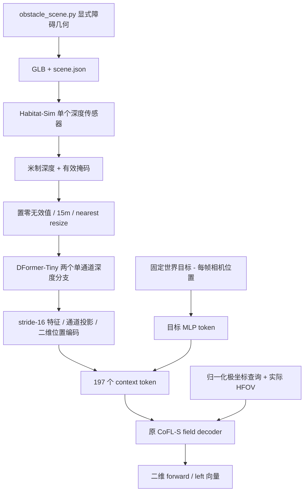

# CoFL-M：仅深度 DFormer → CoFL-S pipeline

本次完成了可运行的模型与场景集成，2026-11-13 在本机 RTX 5080 上实际生成场景、用 Habitat-Sim 采集 4 帧深度，并通过前向、梯度和 checkpoint 检查。**使用随机初始化权重，尚未训练；输出只能用于检查接口，不能据此判断避障、穿缝或飞行能力。**

2026-11-14 场景生成器已改为恒定水平截面的全高柱/墙，默认 45 柱，无圆环和默认窄缝墙；只进行固定高度 XOY 平面规划。下文 54 个物体等数值属于旧实验记录。新生成规则见 [场景文档](cofl-m-obstacle-scenes.md)，新链路产物为 `artifacts/cofl-m/vertical-xy-depth-smoke/`。

## 数据流



视觉观测只有深度。有效性用于预处理，未作为额外输入通道；目标坐标是任务条件。无 RGB 传感器、语言输入、SigLIP 下载或动作分类头。

## 源码入口

| 文件 | 内容 |
| --- | --- |
| `src/cofl/models/vendor/dformer.py` | 官方 DFormer-Tiny 的本地适配，保留完整 MIT 声明 |
| `src/cofl/models/dformer.py` | 深度预处理、空间/目标 token、policy 与 checkpoint |
| `src/cofl/experiments/depth_pipeline.py` | 场景生成 → 独立 Habitat 进程渲染 → 模型推理 → 数值检查 |
| `src/cofl/generation/obstacle_scene.py` | 复用已有场景生成器，输出显式三角网格与深度 |
| `src/cofl/models/cofl_s.py` | 直接复用已有场查询 decoder |
| `configs/generation/habitat_depth.yaml` | 独立 Habitat 环境 recipe |
| `reproduce/test_depth_dformer.py` | 可重复执行的针对性测试 |

没有将新 policy 接入原 RGB-D/语言训练入口或 R2R/VLN 在线 runner；运行入口是上面的独立实验模块。

## DFormer 选择与仅深度适配

选用原版 **DFormer-Tiny**，来源为 [官方 encoder 源码](https://github.com/VCIP-RGBD/DFormer/blob/e3273009b759b578945483828ff315d560be94c9/models/encoders/DFormer.py)，固定 commit 为 `e3273009b759b578945483828ff315d560be94c9`。不是 DFormerv2 或 DFormer++。

- 保留 Tiny 的 stage 深度 `[3,3,5,2]`、通道 `[32,64,128,256]`、heads `[1,2,4,8]`、window `[0,7,7,7]`，以及原 attention/MLP/双分支交互。
- 原主分支 stem 的输入通道从 3 改为 1，辅助分支保留 1；`backbone(depth, depth)` 使两个分支均只接收同一张深度。
- 用原生 PyTorch 的 SyncBatchNorm 和 DropPath 替换所需的框架包装；去除 MMCV/MMEngine、分割 decoder、隐式权重下载及旧 checkpoint loader。本次 `drop_path_rate=0`。
- 主分支已成为深度特征分支。保留双分支是为了先复用 DFormer 的结构，并不意味着得到了两种独立模态。
- 本次不加载原版 RGB-D 预训练权重，全部参数随机初始化。新的完整 policy checkpoint 必须通过严格 `state_dict` 加载；原 CoFL-S/SigLIP checkpoint 不兼容。

另做了与固定版本官方代码的数值对照：官方主 stem 输入复制成三通道的相同深度，将该 stem 权重沿输入通道求和后装入本地单通道版，其余参数相同；四级特征的最大绝对误差为 `1.20e-7 / 1.64e-7 / 6.34e-8 / 4.85e-8` 以内。这验证本地适配保留了该输入条件下的原运算，不代表预训练适配效果已验证。具体结果在实验目录 `upstream-parity.json`。

## 深度、坐标与 token 约定

输入 `depth: float [B,1,H,W]`，单位米，为光轴 Z 深度；`valid_mask: bool [B,1,H,W]` 可选。预处理交集为 `isfinite(depth) & (depth > 0) & (depth < max_depth_m) & valid_mask`。无效值置零，有效值除以固定上限 `15m`；不做逐帧 min-max，不使用 RGB ImageNet 均值方差。

使用 nearest 将原 `320×240` resize 成 `224×224`，避免在无效区及物体边缘插值出虚构深度。该操作会改变图像纵横比；这是当前明确的输入约定，尚未比较保持比例的 padding 方案。原米制 NPY、内参、位姿和有效性掩码仍保留在场景目录中。零值编码无回波，不当成可通行监督。

| 阶段 | 默认形状 |
| --- | --- |
| 模型深度输入 | `[B,1,224,224]` |
| DFormer stage 1 | `[B,32,56,56]` |
| stage 2 | `[B,64,28,28]` |
| stage 3 | `[B,128,14,14]` |
| stage 4 | `[B,256,7,7]` |
| stage 3 → 1×1 投影 → flatten | `[B,196,256]` |
| 拼入目标 token 并 LayerNorm | `[B,197,256]` |
| decoder 输出 | `[B,512,2]` |

空间 token 加入固定二维 sin/cos 位置编码，按图像行优先展平。目标经 `Linear(2,256) → GELU → Linear(256,256)` 编码，除以 `bev_x_max=5m` 后作为一个 token 拼入 context；空间和目标有独立的可学习类型向量。

本次只读取 stage 3 作为 context。stage 4 仍计算并报告形状，但其参数不在当前 field loss 的梯度路径上。辅助分支的梯度受上游 `1e-6` layer scale 影响较小；本次只确认它有限且非零，未验证长期训练收敛。

规划坐标为 `(x前,y左,z上)`；Habitat 坐标为 `(-y,z,-x)`。目标默认固定在规划坐标 `(8,0)m`，位于墙缝后方 1m。每帧 `goal_ego = goal_world - camera_position_xy`。当前生成器相机均为 identity、朝规划 +x，因此平移即可；实验模块拒绝其他相机旋转，扩展旋转视角时需要加入世界到机体的旋转变换。目标无需落在当前 5m 查询范围内。

decoder 默认宽度 256、8 heads、2 层、FFN 512、dropout 0；可通过 `DepthPolicyConfig` 调整宽度，接口不要求与原正式模型的 768 相同。使用原 `CoFLSFieldDecoder` 的预投影 K/V 与 query 接口。

查询为 `16×32=512` 个 `(theta_norm,r_norm)`，分别覆盖 `[-1,1]` 和 `[0,1]`；半径上限 5m，实际 HFOV 90°。输出为归一化的 `(forward,left)` 二维向量，`v_norm=5` 保留在 checkpoint 中。这里没有执行器速度、轨迹积分或动力学闭环。

## 环境与复现命令

模型环境为项目现有 Python 3.12.12、PyTorch `2.7.1+cu128`、NumPy。此路径无需安装 `timm`、MMCV、MMEngine 或 Transformers；已有项目环境可直接运行。新环境至少安装本项目的 `models` extra。

Habitat 使用独立 Python 3.9.23、Habitat-Sim 0.3.3 headless 环境，避免与模型 Python 版本冲突：

```bash
conda env create --prefix .habitat/coflm \
  -f configs/generation/habitat_depth.yaml
```

本机已在 `.habitat/coflm` 建好环境。此次安装根据本机缓存建立临时本地索引后离线完成；这不是通用安装所需步骤。GPU/EGL 需要允许设备访问的执行环境，受限沙盒可能使正常驱动显示为不可用。

从仓库根目录一步生成新场景并运行：

```bash
.venv/bin/python -m cofl.experiments.depth_pipeline \
  --output artifacts/cofl-m/dformer-depth-smoke \
  --habitat-python .habitat/coflm/bin/python \
  --device cuda --frames 4 --backward-check --save-checkpoint
```

输出目录非空时拒绝覆盖，再跑时请使用新目录。默认随机种子 42，场地 `16×10m`，45 根柱、6 个环、地板和左右墙板，共 54 个物体；缝宽 0.65m。相机前向位置为 `0 / 1.8333 / 3.6667 / 5.5m`，高度 1.2m，不穿墙。

复用已渲染场景，无需再次启动 Habitat；CPU 也可运行：

```bash
.venv/bin/python -m cofl.experiments.depth_pipeline \
  --scene artifacts/cofl-m/dformer-depth-smoke/scene \
  --output artifacts/cofl-m/dformer-depth-cpu \
  --device cpu --frames 4 --backward-check
```

使用已保存的新 policy 权重：

```bash
.venv/bin/python -m cofl.experiments.depth_pipeline \
  --scene artifacts/cofl-m/dformer-depth-smoke/scene \
  --output artifacts/cofl-m/dformer-depth-reload \
  --checkpoint artifacts/cofl-m/dformer-depth-smoke/policy.pt \
  --device cpu --frames 1
```

`--goal-world X Y` 设置规划坐标中的固定目标；`--image-size` 只影响新初始化模型；加载 checkpoint 后使用其保存的预处理和模型配置。深度归一化上限必须与场景 far 一致，实际 HFOV 逐次传入 decoder。`--help` 可查看全部参数。

## 产物与本次实测

```text
artifacts/cofl-m/dformer-depth-smoke/
  scene/                 # GLB、stage config、scene.json、depth/valid/preview
  predictions/000000.npz # field [512,2]、context [197,256]、query [512,2]
                         # query_ego_m [512,2]、goal_ego_m [2]
  habitat.log            # 独立渲染进程 stdout/stderr
  report.json            # 环境、初始化状态、形状、延迟与检查结果
  policy.pt              # 完整权重、模型/预处理配置、元数据
  upstream-parity.json   # 额外进行的官方代码数值对照
```

这些运行产物按仓库约定被 gitignore；源码和本文提供重建入口。`upstream-parity.json` 是本次开发验证产物，普通 pipeline 运行不会自动生成。checkpoint 不包含优化器状态，不能直接用作原训练入口的恢复文件。

| 检查项 | 结果 |
| --- | --- |
| 场景渲染 | Habitat-Sim 0.3.3，4 帧，无 RGB |
| 有效深度比例 | 68.04%、73.30%、86.22%、94.00% |
| 每帧 context / field | `[1,197,256]` / `[1,512,2]`，全部有限 |
| 模型参数量 | 6,251,523 |
| 缓存 K/V 与完整 forward 的最大误差 | 0 |
| checkpoint 保存重载后的最大误差 | 0 |
| 将目标向左平移 1m 后 field 最大变化 | 约 0.00711 |
| 将有效深度减半后 field 最大变化 | 约 0.03735 |
| 反向传播 | 两个输入 stem、投影、目标 MLP、decoder 均有非零有限梯度 |

GPU 为 NVIDIA GeForce RTX 5080，FP32、batch 1、224×224，每帧 512 个查询。一次预热后，4 帧 encoder 延迟约 `4.80–5.88ms`，decoder 约 `0.50–0.84ms`，计时包含 GPU 同步，排除 Habitat、磁盘 I/O 和初始化。仅为小样本集成测量，不是稳定吞吐或部署延迟基准。

数值反向检查使用 `mean(field²)`，不执行 optimizer step；这是梯度可达性检查，不是导航训练目标。没有构造虚假的避障标签。

自动测试：

```bash
.venv/bin/python -m pytest reproduce/test_depth_dformer.py -q
```

本次为 **9 passed**，覆盖无效像素/NaN 不影响预测、远裁剪处理、深度与目标敏感性、缓存查询、梯度、严格 checkpoint 重载、非法配置和拒绝未渲染场景。另已在 CPU 上完成 2 帧真实深度的独立 smoke test。

## 后续训练需要补齐的部分

2026-11-14 已新增 [构型空间流场监督设计与几何验证](cofl-m-flow-supervision.md)，包含变形窄缝、不可达、正交缝及相同 Habitat 深度对应相反全局标签的反例。它是独立 teacher 原型，尚未接入这里的模型训练。

当前结果证明数据与模型接口可运行。下一步需要按无人机任务定义目标采样、自由空间、碰撞体和流场监督，再接入数据写出、损失与优化器。变形无人机的多点耦合约束、动力学、穿缝成功率和闭环控制尚未实现；单帧深度也不能提供遮挡后的完整地图。

第三方来源及许可见 [THIRD_PARTY_NOTICES.md](../THIRD_PARTY_NOTICES.md)。官方仓库 LICENSE 为 MIT，README 另有 non-commercial 表述，商用分发前需向作者核实。本次未下载或分发其预训练模型与数据集。
