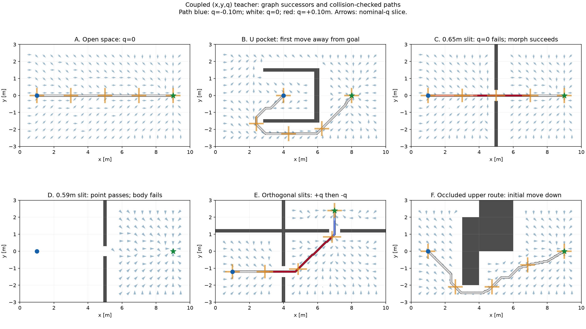
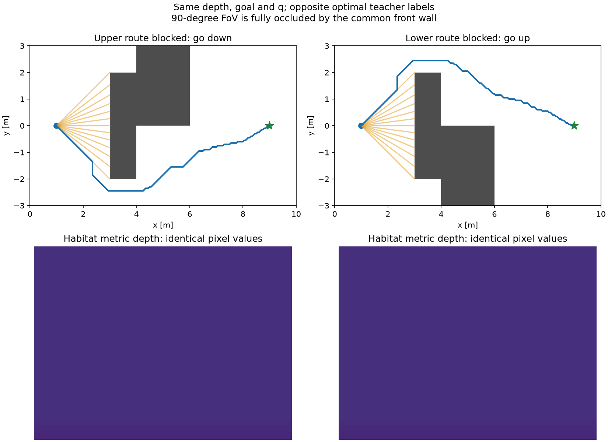

# CoFL-M 流场监督：联合构型 teacher 与虚拟几何验证

日期：2026-11-14。结论来自实际执行的解析碰撞、图搜索和 Habitat 深度对照，不是 DFormer 的预测。**初步建议：先由具有完整几何和耦合约束的构型空间规划器生成监督，再学习该 teacher。不能直接沿用地面导航标签，也不能给四个机体点独立求方向后当成可执行控制。**

本次原型固定飞行高度和 yaw，只规划 `(x,y,q)`；验证几何层面的可行性。真实机体的 CAD 外形、三维姿态、变形速度、推力、控制器和最终任务目标函数尚未纳入。本次没有修改 DFormer policy 或启动训练。

当前任务边界已明确为固定高度的 XOY 平面规划，场景采用全高垂直柱/墙，详见 [当前场景生成规则](cofl-m-obstacle-scenes.md)。下文三维扩展只是此前讨论，不是当前实施范围；平面内 yaw 与形态仍可按任务需要纳入构型。虚拟窄缝反例属于专门测试 fixture，不是新随机生成器的默认场景。

## 1. 为什么监督必须包含形态

仓库的 [硬件边界记录](../amreba_hardware_constraints.md) 指明，AMREBA 的四臂由一个共享变形坐标驱动：

\[
e_1=e_3=0.30+q,\qquad e_2=e_4=0.30-q,\qquad q\in[-0.10,0.10]\ \mathrm m.
\]

这使四个旋翼中心位置在固定朝向下满足：

\[
\begin{aligned}
p_1&=c+(e_0+q,0),&p_3&=c-(e_0+q,0),\\
p_2&=c+(0,e_0-q),&p_4&=c-(0,e_0-q).
\end{aligned}
\]

如果对四个点分别使用单位增益目标吸引 `v_i=g-p_i`，则 `v_c=g-c`，相对运动为 `v_i-v_c=-r_i`。在 q=0 时，x 臂对要求 `q'=−0.30`，y 臂对却要求 `q'=+0.30`，相互矛盾。它会让两对臂同时缩短，违反共享机构的长度守恒；这里的数值仅用于说明矛盾，不是执行器速度。

因此监督的基本对象应为**一组机体构型的联合变化**。已知 `c'` 和 `q'` 后，各点目标运动由同一套运动学推导：

\[
\begin{aligned}
p'_1&=c'+(q',0),&p'_3&=c'-(q',0),\\
p'_2&=c'+(0,-q'),&p'_4&=c'+(0,q').
\end{aligned}
\]

如加入 yaw，则增加共同的旋转项 `ψ' R J r_i`。这些运动学关系可以保证理想模型中的几何耦合，但不能替代碰撞和动力学检查。

构型空间是将机器人姿态与关节形态纳入规划变量的标准抽象；可参考 [LaValle《Planning Algorithms》第 4 章](https://lavalle.pl/planning/node123.html)。这里选择低维子问题是为了检验监督设计，未将实际硬件限制成只能平移。

## 2. 本次实际实现的 teacher

源码：

- `src/cofl/generation/configuration_field.py`：机体代理、扫掠碰撞、构型图、Dijkstra、successor 标签与 mask。
- `src/cofl/experiments/supervision_geometry.py`：几何 fixture、对照实验、GLB 导出、可选 Habitat 渲染和绘图。
- `reproduce/test_configuration_field.py`：独立于 Habitat 的几何和标签语义测试。

### 2.1 机体代理与自由构型

用两根完整胶囊与中心圆盘的并集作为水平机体外形：

| 部分 | 中心线 | 半径 |
| --- | --- | --- |
| 水平臂对 | `[-(0.30+q), +(0.30+q)] × {0}` | 0.085m |
| 竖直臂对 | `{0} × [−(0.30−q), +(0.30−q)]` | 0.10m |
| 中心机体 | 中心圆盘 | 0.12m |

这近似匹配记录中的 q=0 两轴外宽 `0.77 / 0.80m`，以及收缩后的 `0.57 / 0.60m`；胶囊、中心圆盘和 1cm 安全裕度是本次明确选择的代理参数，并非完整 CAD 模型。整根臂取末端尺寸的厚度，可能比真实细臂保守；不能据此声称涵盖所有附件或倾转包络。

对每个构型 `s=(x,y,q)`，检查整个胶囊并集与矩形障碍及场地边界的间隙，要求 `clearance > 0.01m`。不只检查中心或四个端点。

### 2.2 连边要检查中间过程

构型格点取 `Δx=Δy=0.05m`、`Δq=0.025m`。允许 8 邻域平移及相邻 q 变化；本原型不在一条图边上同时平移和变形。

两个端点无碰撞并不足以证明中间过程安全。例如点机器人从 x=0.9m 跳到 x=1.1m，两端都不碰撞，却会穿过 `[0.99,1.01]m` 的薄墙。原型为每条边构造胶囊中心线扫掠区域的包围矩形，再与障碍计算距离并扣除胶囊半径；该区域包含所有线性插值的机体位置，因此所得间隙是保守下界。

固定朝向下的单轴平移和原地变形，该方法对本代理是精确的；对角平移可能过度拒绝某些安全边，但不会因为只检查端点而漏掉扫掠碰撞。原型还对选出路径的每条边取 21 个插值状态，交叉验证其间隙不低于计算下界。

[OMPL 的状态与运动有效性说明](https://ompl.kavrakilab.org/stateValidation.html) 也明确区分单个状态和整段运动的检查；仅用稀疏采样可能遗漏碰撞。

### 2.3 图上的目标函数

所有边满足硬碰撞约束后，以如下正边权构造一个**示范目标函数**：

\[
w(s,t)=\bigl(\|\Delta c\|_2+2|\Delta q|\bigr)
\left[1+0.2\max\left(0,1-\frac{d_{\rm edge}}{0.25\,\mathrm m}\right)\right].
\]

`d_edge` 为扫掠间隙下界；第一项惩罚路径和变形量，第二项温和惩罚靠近障碍。这些权重用于此次可行性实验，并不是用户最终目标函数，也不是无人机动力学参数。裕度之外的更大间隙是软偏好，不会把所有窄缝都作为硬障碍封死。

目标构型是指定的 `(goal_x,goal_y,q=0)`，因此成功路径在通过窄缝后会恢复普通形态。固定形态对照则起终点都保持该固定 q。目标落入碰撞区时，不自动吸附到其他自由格点。

### 2.4 从价值函数生成场标签

从目标在无向正权图上运行 Dijkstra：

\[
V(s)=\min_{\pi:s\to g}\sum_{(u,v)\in\pi}w(u,v).
\]

为每个可达构型选择 Bellman 最优的 successor：

\[
t^*(s)\in\arg\min_{t\in\mathcal N(s)}\{w(s,t)+V(t)\}.
\]

保存原始 successor，并将差分归一化为构型场切向量：

\[
F^*(s)=\frac{(\Delta x,\Delta y,\Delta q)}
{\sqrt{\Delta x^2+\Delta y^2+(2\Delta q)^2}}.
\]

纯 q 动作的第三分量为 `±0.5`，因为采用了上述加权构型度量；它**不是物理 q 速度**。第三分量不能直接套用原 CoFL-S 的统一 `v_norm` 作为控制指令。实际输出时间化、速度限制与动力学需要另行设计。

goal 的场为零，并有 `terminal=True`。不可达构型的 `V=inf`、`reachable=False`、`terminal=False`；其存储向量虽为占位零，但不能进入回归 loss。碰撞、不可达和到达不能合并成同一种 STOP 标签。

所有可达非终点 successor 均严格降低 V，故沿离散 successor 不会出现非目标循环。这是**该图及本代理上的保证**；不是连续空间全局最优，也不意味着对标签平滑、神经网络回归或双线性插值后仍然安全。选择 successor 而非直接平滑 `−∇V`，是为了保留一条明确经过边检查的可行运动。

## 3. 虚拟几何的实测结果



图中灰色为障碍，蓝点为起点，绿星为终点；路径颜色表示 q。箭头展示 q=0 的场切片，所以纯变形动作在这个切片上没有二维箭头。路径可能经过不同 q，不能把路径与 q=0 切片当成同一个二维静态场。

| 几何 | 对照与结果 | 说明 |
| --- | --- | --- |
| A 空旷区域 | q=0 直行 8.00m 到目标 | 基本标签与终点语义正确 |
| B U 形口袋 | 起点先向后退出，再绕到目标；路径约 9.42m | 单纯朝最终目标吸引会朝封闭端移动；图 teacher 能给出退让动作 |
| C 0.65m 墙缝 | q=0 不可达；变形路径可达，最大 q=+0.10m | 变形后横向外宽 0.60m，含两侧裕度为 0.62m，小于缝宽 |
| D 0.59m 墙缝 | 点机器人可通过；整个机体在固定 yaw 下不可达 | 点导航的标签会误判机体可通行 |
| E 正交 0.65m 缝 | 三种固定形态对照均失败；联合路径可达 | 第一道取 q=+0.10m，第二道取 q=−0.075m，最后回到 q=0 |
| F 遮挡后的绕行 | 相同初始深度下，上方被堵应向下、下方被堵应向上 | 当前输入不能唯一确定全局最优标签，见后文 |

几何上，竖墙缝要求横向宽度满足：

\[
0.80-2q+2(0.01)<0.65\quad\Rightarrow\quad q>0.085\,\mathrm m.
\]

正交横墙缝则要求：

\[
0.77+2q+2(0.01)<0.65\quad\Rightarrow\quad q<-0.070\,\mathrm m.
\]

因此不存在一个固定 q 同时满足两道缝；联合路径必须在中间空间切换形态。实测路径长约 8.31m，最小扫掠间隙下界 0.015m。0.65m 单缝路径长 8m，扫掠间隙下界 0.025m；这些均超过本次 0.01m 裕度。

将两个单缝实验的空间分辨率从 0.05m 加密到 0.025m 后，0.65m 可达、0.59m 不可达的判断一致。0.59m 的固定朝向不可达还可从最小横向外宽加裕度 `0.60+0.02=0.62m > 0.59m` 直接判断；这不是只凭一次有限搜索失败作出的结论。

另有一个边界反例：0.65m 方形空腔内，固定 yaw=0 时不存在可行 q；但 q=0、yaw=45° 时，该十字胶囊代理两轴总外宽均约为 0.6243m，加裕度后约 0.6443m，可静态放入。这只是单个姿态的静态检查，**未验证旋转进入空腔的路径**。它说明固定 yaw 的不可行不能推广为真实无人机所有姿态都不可行。实际姿态约束需要扩展到 `(x,y,ψ,q)`，再到三维 `SE(3)×q`。

## 4. 两类不能忽略的输入缺失

### 4.1 q 缺失使形态监督不唯一

在同一个 0.65m 缝场景、同一个 `(x,y)=(1,0)` 处：

- q=0 的 teacher 标签是 `(0,0,+0.5)`：先变形。
- q=+0.10m 的标签是 `(1,0,0)`：可以前进。

当前 DFormer policy 的输入没有 q，仅有深度和目标坐标。在本次无自身遮挡的固定传感器模型下，上述两种状态的外部深度相同，因此必须显式输入当前/查询构型的形态信息。单纯将二维 head 改成三维仍然不够。

### 4.2 相同深度也不一定有相同全局最优动作



构造相同前墙和互为上下镜像的隐藏障碍。相机在 `(1,0,1.2)m`，朝 +x，HFOV 90°；前墙遮住整个视锥，目标均为 `(9,0)m`，q 均为 0。

Habitat-Sim 实际渲染结果：

- 两张 float32 深度图均为 `240×320`，逐像素最大差 **0m**。
- 有效性 mask 完全相同。
- 上方绕行被堵时，起始 teacher 切向量约为 `(+0.707,−0.707,0)`。
- 下方绕行被堵时，起始 teacher 切向量约为 `(+0.707,+0.707,0)`。

这是输入信息不足的反例。对于同一深度、最终目标与 q，确定性单帧模型只有一个输出，无法同时精确复现两个不同全局最优标签。均方误差可能将左右分量平均成零，并不等于获得了正确的全局策略。

**仅屏蔽被遮挡的 query 点也解决不了这个矛盾**：起点本身可见，但其最优方向依赖遮挡后的布局。增大 encoder 宽度、换预训练权重或增加相同类型的训练样本，也不会凭空补齐缺失的信息。

可选择的任务定义为：

1. **全局 teacher 路线**：输入增加已经观测得到的地图/有效历史，或由拥有地图的上层规划器提供局部路由目标；历史只有在确实提供额外信息时才有帮助。
2. **仅当前深度的局部路线**：teacher 也限制在当前可观测信息内，监督短时安全动作、已知自由区域的局部引导和探索策略；接受它不保证初次观测就选中全局最短绕行方向。

不能用不可见真值选择分支，再将其包装为“单帧可唯一推断”的监督。完整真值几何用于离线碰撞和 teacher 规划是合理的，但学生的输入与监督任务必须相容。

## 5. 如何接入下一版数据与模型

建议按下列顺序推进：

1. **确定任务状态和目标函数。** 若先做固定高度/朝向实验，teacher 采用 `(x,y,q)`；如需转体穿缝，加入 ψ。路径、形态、姿态、间隙等代价由任务明确；要宣称动力学可行，再加入真实速率、推力和控制约束。
2. **从显式场景建立正确碰撞查询。** 对当前 `obstacle_scene.py`，使用 box、柱、环的几何或 GLB mesh 计算机体碰撞，不借用地面 navmesh。真实无人机有厚度，不能只取高度平面一条截线；直接将三维 mesh 全部投影到二维又可能错误封闭可穿越的孔洞。需要按三维机体体积检查，或明确保守的高度带代理。
3. **先生成全局 teacher，再采样可行构型。** 对每个场景/目标求价值或规划路径，保留可达状态、不可达状态、形态切换点、终点和近障碍样本。图搜索可生成当前低维场的稠密标签；更高维可以使用状态格或采样规划器，并由经过验证的轨迹构造局部监督，不能从一条稀疏轨迹声称已经得到全空间最优场。
4. **让观测与 teacher 状态对齐。** 在碰撞可行的机体/传感器位姿渲染深度，保存相机内外参、位姿、q、目标、可观测区域和标签来源。现有场景生成器的相机通道只保障相机采样，不能自动充当机体可行轨迹。
5. **决定网络角色。** 若学习联合 teacher，应增加 q（后续 ψ）条件，将 query 扩展为构型查询，输出联合切向量，并重新定义各维归一化。若继续保留当前二维 CoFL-S head，应将其限定为位置引导，并由独立的联合规划/约束控制层决定姿态和 q；不可用二维场声称已学会变形。
6. **再开始拟合与闭环评估。** 可先做小场景过拟合检查数据对齐，再评估未见场景、完整机体碰撞、穿缝成功率、形态约束、路径/任务代价及失败识别。对多条近优路径，采用路由条件或候选动作/Q 值等方式保留分支，避免把互斥方向平均后视为可行方向。

训练样本应把观测/目标条件与 `query=(x_query,y_query,q_query)` 配对；q 可以作为查询维度，也可以先固定一个 q 切片并显式提供该条件。当前相机实际所在构型与被查询的假想构型需要区分。对当前极坐标 decoder，要先把 query 变成相机系米制坐标，从 teacher 查询并转换标签，再进行约定好的归一化；不能把世界坐标场直接当作机体系标签。

在输入信息充分且分支已确定的初期，可以对 `reachable=True` 的非终点做加权构型切向量回归，对终点单独约束输出为零；方向 loss 的内积应使用与 teacher 一致的缩放 `(1,1,2)`。如增加可达性或价值预测 head，再使用显式可达标签、有限且归一化的 V，不能把 `inf` 送入 loss。这里仅提出训练接口，尚未新增这些 head 或损失；有限样本的回归准确率也不能代替最终的扫掠碰撞验证。

本次导出的 NPZ 为 teacher 开发格式，轴顺序 `[Nq,Ny,Nx]`：

```text
x, y, q                 # 各轴米制坐标
value                   # 带形态和间隙代价的 V；不可达为 inf
field[...,3]            # 构型场切向量，非执行器速度
collision_free          # 整体机体在该构型下满足间隙要求
reachable               # 到指定目标构型可达，回归标签有效性
terminal                # 目标；与不可达严格区分
predecessor             # 经过扫掠检查的下一节点
```

正式数据还需要场景、目标、代理/硬件模型版本和代价参数绑定，并根据选定的观测任务增加相关 mask/路由信息。本次没有把这些 NPZ 接入原生 CoFLDataset 或模型训练入口。

## 6. 复现与产物

仅数值验证，不依赖 Habitat 或 Torch：

```bash
.venv/bin/python -m cofl.experiments.supervision_geometry \
  --output artifacts/cofl-m/supervision-geometry-numeric
```

加入两个遮挡场景的 Habitat 深度复核：

```bash
.venv/bin/python -m cofl.experiments.supervision_geometry \
  --output artifacts/cofl-m/supervision-geometry-verified \
  --habitat-python .habitat/coflm/bin/python
```

需要项目现有 NumPy、SciPy 和 Matplotlib；Habitat 用上一阶段建立的独立 Python 3.9 / Habitat-Sim 0.3.3 环境。该命令默认拒绝覆盖非空目录，再跑需使用新输出目录。GPU/EGL 的可用权限与上一阶段相同。

实测产物位于 `artifacts/cofl-m/supervision-geometry-verified/`，包括：

- `report.json`：**14/14 项检查通过**。
- 每个对照的 `.npz` teacher 场及 `*-path.npy` 构型路径。
- `geometry-overview.png`、`observation-alias.png`。
- 各几何的 `scene-*/` GLB 与配置；遮挡场景还包含真实 Habitat 深度、mask 与日志。该 fixture 使用自定义采样位姿，`gap=null`，不是默认的程序化墙缝 manifest。

自动测试：

```bash
.venv/bin/python -m pytest \
  reproduce/test_configuration_field.py reproduce/test_depth_dformer.py -q
```

实测 **16 passed**：包含前一阶段的 9 项模型检查，以及 7 项新增几何测试，覆盖形态包络、扫掠薄墙、插值间隙下界、变形可达性、终点/不可达语义、正交缝、价值下降、目标不吸附和观测矛盾。

本次结论支持继续开发**构型空间 teacher**。它同时给出了现有输入与二维输出不足的明确反例；尚未证明真实无人机动力学可行、连续神经流场安全或复杂三维场景中的闭环性能。
