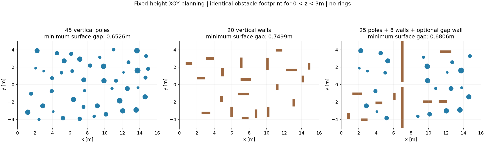

# CoFL-M: 简单障碍场景与深度采集

入口为 `src/cofl/generation/obstacle_scene.py`。当前 CoFL-M 只做固定高度的 **XOY 平面规划**。场景只生成全高垂直圆柱和垂直矩形墙面，取消圆环；所有障碍在 `0 < z < height` 的水平截面相同。地板位于 z=0 以下，不参与障碍间距检查。全部几何是显式三角网格，Habitat 只创建深度相机，不创建 RGB/语义相机。

2026-11-14 已更新生成规则。已有旧场景文件不自动改变，应使用新目录重新生成。默认 45 根柱子，不生成墙；墙面和带缝墙均可选。

这是场景与观测生成工具，尚不是 `CoFLDataset`，不生成流场标签、不运行无人机动力学。现在可接入实验性的单通道 DFormer 编码与 CoFL-S decoder，见 [深度 DFormer pipeline 技术说明](cofl-m-depth-dformer-pipeline.md)。该适配显式修改原 RGB-D encoder 的输入 stem，首次验证使用随机初始化权重。

## 只生成场景：使用现有项目环境

从仓库根目录运行，无需安装 Habitat：

```bash
uv run --locked python -m cofl.generation.obstacle_scene \
  --output artifacts/cofl-m/obstacles-seed42 \
  --seed 42 --poles 45 --min-clearance 0.65 \
  --generate-only
```

默认场地长 16m、宽 10m、柱高 3m，柱半径 0.12–0.32m，全部从 z=0 延伸到 z=3m。相机/规划高度默认 1.2m；可改变固定高度，障碍截面不变。种子固定时场景一致。

**间距定义为表面到表面的最短水平净距，不是中心距。** 柱—柱采用 `中心距 − 两柱半径之和`，柱—墙采用圆到矩形的净距，墙—墙采用矩形间最短距离。所有障碍对都要求净距严格大于 `--min-clearance`（默认 0.65m，允许增大）；生成后另做全对检查。随机障碍到采样区域边界也预留该净距，并保留相机采样通道。圆柱的解析外接圆用于净距检查，比 GLB 的 24 边形截面略保守。

柱间净距约束是这里“场景可行”的具体检查条件。障碍内部不能作为自由点；对实际尺寸、姿态或变形范围的整机，任意自由点之间是否可执行仍需对应构型碰撞检查，不能只凭 0.65m 净距作整机保证。固定高度并不排除平面内 yaw；本生成器不限定规划器的朝向选择。

纯垂直墙面：

```bash
.venv/bin/python -m cofl.generation.obstacle_scene \
  --output artifacts/cofl-m/vertical-walls --poles 0 --walls 20 --generate-only
```

随机墙面有两种轴向，长边 0.6–1.4m、厚度默认 0.25m，全部贯穿场景高度。柱墙混合并启用带缝墙：

```bash
.venv/bin/python -m cofl.generation.obstacle_scene \
  --output artifacts/cofl-m/vertical-mixed \
  --poles 25 --walls 8 --gap-wall 1 --gap-width 0.70 --generate-only
```

仅带缝墙：

```bash
.venv/bin/python -m cofl.generation.obstacle_scene \
  --output artifacts/cofl-m/gap-only --poles 0 --gap-wall 1 --generate-only
```

带缝墙默认关闭。启用后位于 x=7m，厚 0.25m、缝宽默认 0.70m，缝宽同样必须大于最小净距。相机采样线会停在墙前。放不下指定数量的物体时明确报错，需扩大场地或减少数量；不会缩小间距或静默少放物体。旧选项 `--rings` 仅接受 0，非零会提示圆环已禁用。

现成工具核查：已查看 [EGO-Planner 官方 random forest 源码](https://github.com/ZJU-FAST-Lab/ego-planner-swarm/blob/master/src/uav_simulator/map_generator/src/random_forest_sensing.cpp)，其 `min_distance` 检查中心间距、柱高度仍随机采样，且还有圆环生成。它不能直接保证本任务的表面净距和恒定截面，因此这里沿用并修改已有 GLB/Habitat 生成器，不引入 ROS 点云转换链路。

所有选项见 `--help`；输出目录非空时拒绝覆盖。

## Habitat 环境渲染

在安装有 Habitat-Sim 和 NumPy 的独立环境执行同一文件，可以避免安装整个项目及 Torch。目标版本为 Habitat-Sim 0.3.3；无需 Bullet。GPU 渲染依赖可用的 OpenGL/EGL 驱动。不要在此步骤启动旧 R2R/VLN-CE worker。

需要长期使用时，可以创建独立环境：

```bash
conda create -n coflm-habitat python=3.9 habitat-sim=0.3.3 headless \
  -c conda-forge -c aihabitat --override-channels
conda activate coflm-habitat
```

在仓库根目录激活 Habitat 环境后：

```bash
python src/cofl/generation/obstacle_scene.py \
  --output artifacts/cofl-m/obstacles-seed42 --render-existing
```

也可一步创建新场景并渲染：

```bash
python src/cofl/generation/obstacle_scene.py \
  --output artifacts/cofl-m/obstacles-seed7 --seed 7
```

默认采集 16 帧、320×240、水平 FOV 90°、相机高度 1.2 m，沿中心线从前向坐标 0 m 移至 5.5 m，停在墙前；这是观测采样，不是穿越规划。可用 `--frames`、`--camera-end`、`--camera-height`、`--hfov-deg`、`--near`、`--far` 调整。每帧直接设置相机状态，不使用导航网格限制。

## 输出约定

```text
scene.json                      # 参数、几何、内参、位姿、planning 与 geometry_audit
obstacles.glb                   # 可独立加载的静态场景
obstacles.stage_config.json     # 同一 mesh 用于渲染和碰撞资产
depth/000000.npy                # float32 [H,W] 米制光轴 Z 深度
valid/000000.npy                # bool [H,W] 有效性；无回波/远裁剪为 False
preview/000000.png              # 16-bit 灰度预览，非训练用的原始深度
```

深度不是到相机中心的欧氏射线距离。无效深度置零；`near`/`far` 明确写入 manifest。预览按 `[0,far]` 映射至 16-bit 灰度，不包含 RGB 外观信息。

规划坐标采用 x 前、y 左、z 上；导出的 GLB 使用 Habitat 的 Y 上、相机朝 -Z：

```text
(X_habitat,Y_habitat,Z_habitat) = (-y_planning,z_planning,-x_planning)
```

`scene.json` 同时记录两种位置。相机姿态为 Habitat identity quaternion，坐标系不可与米制深度混用。内参采用整数像素中心约定，主点 `((W-1)/2,(H-1)/2)`。

后续接 generation 时应从这些显式障碍几何构造飞行高度处的自由区域，再复用 CoFL-S 的代价图和流场计算。这里不制作解析漏斗场，不包含多点配对或机型约束。

## 当前验证



12 个种子的默认柱林、柱墙混合、纯墙面、距离定义、全高网格、禁用圆环及拥挤场景失败行为均有测试：

```bash
.venv/bin/python -m pytest reproduce/test_obstacle_scene.py \
  reproduce/test_configuration_field.py reproduce/test_depth_dformer.py -q
```

实测 35 passed。新场景的 `geometry_profile=vertical_extrusion_xy_v1`；`planning` 记录 XOY 平面和固定高度，`geometry_audit` 记录实际最小净距和检查对数。种子 42 默认柱林（45 柱）的最小净距为 0.6525678m；20 面纯墙为 0.7499463m；25 柱＋8 墙＋带缝墙为 0.6806286m。

新柱林的 Habitat + DFormer 实验输出在 `artifacts/cofl-m/vertical-xy-depth-smoke/`，其生成规则与之前含圆环的实验不同；旧实验报告保留历史实测数据。

2026-11-15 已生成按场景划分的 6 场景 / 96 帧预览集，并复用已有 CoFL Studio 展示，见 [Habitat 场景集与可视化说明](cofl-m-habitat-preview.md)。
