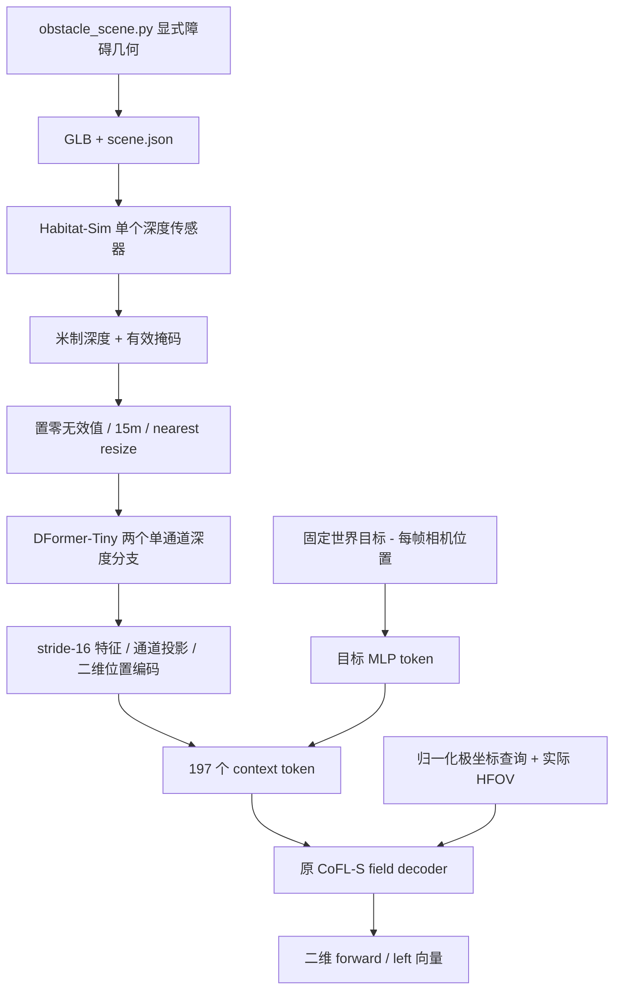
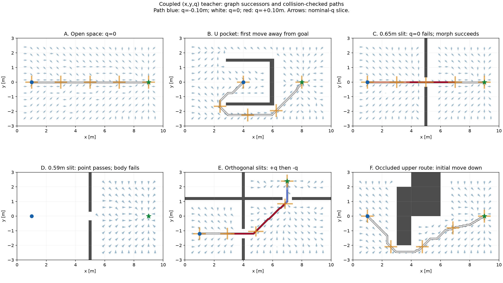
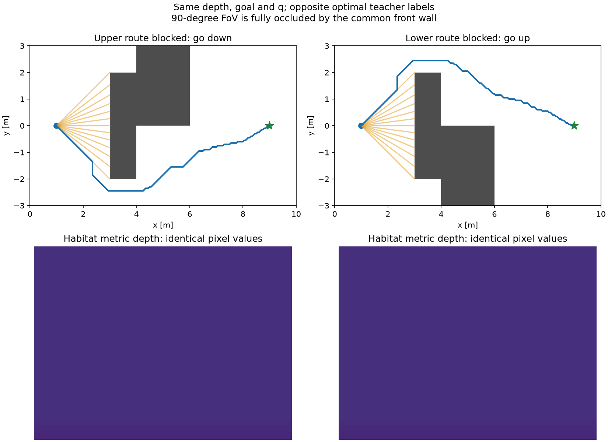

# 开发与实验记录

整理日期：2026-11-16。此前分散的开发上下文、学习上下文及阶段实验记录统一归档于本文，保留原有推导、命令、实测结果和限制；各节日期表示原记录时间，历史计划和测试数量不代表当前实现状态。

命令和源码路径均相对仓库根目录；文档链接按本文位置调整。

当前任务为固定高度的 XOY 平面规划，使用纯深度观测和构型空间 teacher；DFormer 尚未完成任务训练。当前代理的横纵外轮廓为 `0.80±2q` 米、面宽 20cm。历史记录中的尺寸更正和旧场景结果仍随原文保留。

用户入口保留在 [Studio 教程](cof-m-studio.md)、[场景生成与深度采集](cof-m-obstacle-scenes.md) 和 [硬件约束参考](../amreba_hardware_constraints.md)，原版项目手册、复现指南与第三方声明也独立保留。

名称统一使用 `cof-m`。现有 `coflm` API/配置标识、`cofl_m_*` 数据格式、`.habitat/coflm` 环境以及 `artifacts/cofl-m/` 历史产物路径保持兼容；它们是技术标识或已有目录。

## 目录

- [项目开发上下文（2026-11-10）](#project-context)
- [Transformer 学习上下文（2026-11-09）](#transformer-context)
- [仅深度 DFormer 集成与实验记录（2026-11-13）](#depth-pipeline)
- [构型空间流场监督与几何验证（2026-11-14）](#flow-supervision)
- [Habitat 场景与观测预览记录（2026-11-15）](#habitat-preview)

<a id="project-context"></a>

## 项目开发上下文（2026-11-10）

整理日期：2026-11-10。用于在手机或新的 ChatGPT 对话中继续讨论。本文件是讨论摘要，不是已完成实现的报告。

### 1. 用户目标与当前决定

- 基于当前 CoFL 仓库开发，主要复用 **CoFL-S**，不使用原始 BEV CoFL 作为主模型。
- 面向**变形无人机**：关注机体上多个点的运动，这些点需要联合满足几何、运动等约束，并优化用户定义的目标函数。具体约束方程、目标函数及状态表示尚未确定。
- 曾讨论固定高度飞行、在虚拟水平平面上输出二维流场；最终是否只在二维平面运动，尚未最终确定。
- 初期考虑仅深度输入、普通 CNN 或 DINO；后续更新为计划采用 **DFormer RGB-D encoder**。
- 不需要语言指令输入（原模型是文本指令，不是语音输入）。计划使用内置目标坐标条件。
- 希望继续使用现有 CoFL-S 流场 decoder 的结构和输出形式。但多点耦合运动是否适合原输出形式，仍需论证。
- 这是独立发展分支，今后不打算合并回原 CoFL。建议自己的远程仓库作为 origin；尚未执行新建仓库或修改 remote。
- 当前没有开始 DFormer 替换，也没有实现无人机约束模块。

### 2. 涉及的仓库与资料

#### 当前 CoFL 源码仓库

- 本地目录：`/home/kuma/ros/learning_ws/CoFL`
- 同时包含两项工作：
  - CoFL：鸟瞰 RGB＋语言，查询图像平面坐标，输出二维图像向量。
  - CoFL-S：第一人称 RGB-D＋语言，查询局部水平扇区坐标，输出机器人坐标系 `(forward, left)` 二维向量。
- 本次没有核实当前 Git remote 的 URL，后续应执行 `git remote -v`，不要猜测上游 GitHub 地址。
- 模型说明：`docs/models.md`
- 数据生成：`docs/generation.md`
- 推理规范：`docs/inference.md`
- 数据格式：`docs/dataset-format.md`
- 训练说明：`docs/training.md`
- 学习背景：[Transformer 学习上下文](#transformer-context)。后续回答沿用其中 PDF 编号、数学符号、每 token 一行的约定，不从基础重复讲起。

#### DFormer 官方仓库

- https://github.com/VCIP-RGBD/DFormer
- 包含 DFormer、DFormerv2、DFormer++；具体采用哪个版本尚未最终决定。
- 官方 encoder 文件：
  - `models/encoders/DFormer.py`
  - `models/encoders/DFormerv2.py`
- 目标是复用 RGB-D encoder，**不使用其语义分割 decoder 和整套分割训练框架**。
- 原版依赖 mmcv、mmengine；与本项目环境的实际兼容性尚未运行验证。
- 上游根 LICENSE 为 MIT，但 README 另有 non-commercial 表述。保留来源与许可，发布前需确认适用条件。

#### CoFL-S 发布资产

- 模型：https://huggingface.co/lhk66666/CoFL-S
- 数据：https://huggingface.co/datasets/lhk66666/CoFL-S-Dataset
- 已通过 Hugging Face API 查看模型：`best.ckpt` 为 **5,336,379,647 字节，约 5.34 GB / 4.97 GiB**。
- 完整 checkpoint 包含模型及恢复相关内容；文件大小不等于纯参数大小或运行显存。
- 已查到数据仓库有 92 个归档，总计约 **329.48 GiB**。
- 下载文件需要 HF 授权与登录。当时本机未配置 HF token，实际文件请求返回访问受限。
- 当时当前磁盘可用约 318 GiB，无法同时存下全量归档，解包另需空间。
- 没有下载该训练数据集。

### 3. 当前 CoFL-S 模型结构

```text
RGB → SigLIP 视觉塔 → RGB patch tokens ─→ 深度 FiLM 调制 ─┐
Depth + valid mask → depth patch adapter ────────────────┘
                                                        ↓
                                                  视觉投影 + LN
                                                        ↓
Text → SigLIP 文本塔 → pooled token + text tokens → 文本投影 + LN
                                                        ↓
                                         4 层视觉语言融合 → LN
                                                        ↓
                                              context C [B,Nc,d]
                                                ├→ 流场 decoder
                                                └→ Action Head
```

正式配置 `configs/cofl_s_formal.yaml`：

- `d_model=768`，任务网络 `num_heads=8`，每 head 为 96 维。
- 4 层视觉语言融合，2 层流场 decoder。
- SigLIP 为 `google/siglip2-base-patch16-224`。
- 224×224 图像得到 196 个视觉 patch token。
- 文本默认 64 个位置，外加 pooled prefix，共 65 个特征 token。
- context 仍为视觉 token 序列，不是直接拼接全部视觉和文本 token。
- 视觉与文本塔在正式配置中均 `unfreeze_last_n_layers=-1`，参与训练。
- 当前只接收单帧，没有显式时序记忆模块。

#### Encoder 与 decoder 的解耦接口

```python
context = encoder(...)                     # [B,Nc,d]
query_context = decoder.prepare_context(context)
field = decoder.decode(query, query_context) # query [B,N,2] → field [B,N,2]
```

Decoder 不要求 context 一定来自 RGB、语言或 SigLIP，也不要求 Nc 必须是 196。
但现有 policy、训练数据处理、优化器分组和 checkpoint 对 SigLIP 有工程耦合，需同步修改。

#### 流场 decoder

- 查询：归一化极坐标 `(theta_tilde,r_tilde)`。
- 追加 HFOV 条件，Gaussian Fourier encoding → Linear → LN。
- 经过 Pre-LN Cross-Attention＋MLP＋残差。
- Q 来自空间查询特征，K/V 来自 context。
- 当前 `need_self_attn=False`：空间 query 之间没有直接相互注意力。
- 输出方向头和非负幅值头，二者相乘得到 `(forward,left)`。
- 场向量经过尺度归一化，不是可直接发送给执行器的速度命令。

### 4. models 中脚本的职责

| 文件 | 职责 | 新项目倾向 |
|---|---|---|
| `backbone.py` | SigLIP 视觉、文本塔与 processor | 换为 DFormer 包装层 |
| `depth.py` | 深度特征对 RGB token 做 FiLM 调制 | DFormer 已融合 RGB-D，可移除旧路径 |
| `projection.py` | 视觉和文本分别投影到任务宽度 | 改为空间 token adapter |
| `fusion.py` | 视觉 Self-Attention＋读取语言的 Cross-Attention | 无语言后移除或改造 |
| `encoders.py` | 编码器总装配 | 改为 RGB-D＋目标条件 |
| `cofl_s.py` | CoFL-S 流场查询 decoder | 优先保留 |
| `blocks.py` | Attention、Fourier、Pre/Post-LN block | 保留所需部分 |
| `action.py` | 四分类动作 head | 新任务初期倾向去掉 |
| `policies.py` | encoder、decoder、action 的总接口 | 简化为新 policy |
| `cofl.py` | BEV CoFL decoder | 不作为新项目主路径 |
| `__init__.py` | 类导出 | 按新接口调整 |

### 5. Action Head 与实际部署

Action Head 和流场 decoder 是**并列分支**，都读取 context。Action Head 不是 decoder 的提前输出。

- 动作顺序：STOP、MOVE_FORWARD、TURN_LEFT、TURN_RIGHT。
- 原在线正常控制：预测流场 → 积分轨迹 → Pure Pursuit → 线速度/角速度。
- 动作 head 用于 STOP 仲裁、流场轨迹退化时的备用动作。
- 另有振荡恢复逻辑，具体优先级见 `online/dynamics.py::ActionArbitrator`。
- 因此不能把原系统简单说成“动作分类直接决定每一步方向”。
- 原 `CoFLSPolicy.forward()` 只返回流场，动作通过 `action_logits(context)` 单独调用。
- 新项目若目标坐标和位姿已知，可按距离做到达判断，但删除 action head 时必须同步改训练及在线代码，不能只改一个开关后沿用所有入口。

### 6. DFormer 替换方案与仓库组织建议

```text
RGB + Depth
    ↓
DFormer 多尺度特征图
    ↓
Token Adapter：选尺度 → 通道投影 → 二维位置编码 → 展平
    ↓
context C ← 目标条件
    ↓
现有 CoFL-S decoder ← 空间查询
    ↓
二维场
```

- 原版 DFormer `forward(rgb,depth)` 返回 `(outs,None)`；v2 返回特征 tuple，包装层统一接口。
- 可先测试原版 Tiny。四级通道 32/64/128/256；224×224 输入对应 56²/28²/14²/7² 特征图。
- 第一版可从 stride-16 的 14×14 特征映射到 768 维，形成 196 个 token。
- 显式加入二维位置编码：flatten 顺序本身不会告诉 Cross-Attention 图像空间位置。
- 旧 decoder 权重可以作为初始化候选，但新旧 context 分布不同，不保证冻结即可使用。
- 预处理必须匹配选定 DFormer 权重；米制深度与 encoder 输入规范分开保留，不能直接照搬 SigLIP/旧深度归一化。
- DFormer 性能、延迟、当前 PyTorch 兼容性尚未实测。

建议组织（尚未实施）：

```text
src/cofl/models/
  backbones/dformer.py
  adapters/spatial_tokens.py
  conditioning.py
  encoder.py
  policy.py
  cofl_s.py
  blocks.py
src/cofl/data/preprocessing.py
third_party/dformer/          # 选定源码、许可证、上游 commit 和修改说明
configs/rgbd_goal_field.yaml
```

不需要为未来合并原项目保留复杂兼容分支。初期保留包名，接通训练后再清理旧代码。

必须一起调整：

- `training/policy.py`：构建、预处理、加载。
- `training/data.py`：移除 SigLIP processor 重建。
- `training/module.py`：动作损失、视觉/文本优化器分组、checkpoint assets。
- `training/config.py`：改为新 encoder 与目标配置。
- `online/policy.py`：移除对 action head 的无条件调用，更新输入。
- checkpoint：保存新架构、预处理、完整 state_dict 和场几何配置。

#### 目标坐标的区别

- 恒定机体相对目标，例如每帧前方 5m：可以将规则内置，但会持续向前，并不等于到达最初世界点。
- 固定世界目标：必须每帧转换为机体相对目标 `goal_ego`，需要位姿信息。
- 可将相对目标用 MLP 编成 goal token；确切条件注入方式待实现。

### 7. 原训练数据的含义与 Dijkstra 顺序

原数据是任务监督数据，不是单独 encoder 的预训练集。

输入：RGB-D＋指令；主要标签：流场；附加动作标签、mask、几何信息等。

当前仓库的流场标签生成顺序：

```text
仿真可通行几何 + 目标
    ↓
建立栅格图：距离 + 可选安全代价
    ↓
从目标运行 Dijkstra → 代价距离 + 前驱树
    ↓
势函数、负梯度、平滑与障碍处理
    ↓
监督流场
```

- Dijkstra 在**标签生成之前**运行，不是在预测流场后才找最短路。
- 图上的最小代价体现路径长度和可选安全偏好。
- 自由区方向来自势函数负梯度，幅值关联同一前驱树上的剩余几何路径长度 / v_norm。
- 后处理、模型拟合和轨迹积分没有严格全局最优保证。
- 当前部署推理以预测场积分轨迹，不在该控制链内重新运行 Dijkstra。
- 这是本地现有代码的结论；未逐项验证发布数据的历史生成配置完全一致。

### 8. 对 329 GiB 数据是否有用的最终结论

用户关心的是：能否直接训练自己的新约束任务，而不是“理论上能否用于预训练”。

**结论：不能把原数据中的地面语言导航流场直接当作变形无人机多点约束、新目标函数的正确监督。没有必要为了当前目标先下载全量数据。**

- 仅换 encoder，任务不变：原监督可以继续用。
- 换成用户的新优化问题：需要新规则下的监督标签。
- RGB-D 观测及原任务预训练仍有潜在用途，但这不是用户当前要的直接可用数据。
- 发布 RGB-D 不等于完整场景几何，不能假定仅靠这些观测就能重新做完整碰撞与最优规划。
- 删除语言改用坐标时，需要与标签匹配的真实目标元数据；不能把截断轨迹终点直接当成最终目标。

之前回答一度把“可用于预训练”泛称为“可以用”，已明确纠正。后续请直接围绕新任务监督回答，不再混淆。

### 9. 多点耦合约束：尚待确定的关键设计

原场为 `v(p)`，各空间查询独立；用户可能需要对多个机体点的联合状态 P 输出联合运动 U：

\[
U^*(P)=\arg\min_U J(P,U),\qquad c(P,U)=0,\quad h(P,U)\leq0.
\]

逐点查询再拼接不能自动保证机体几何、变形和碰撞约束。

待比较的路线：

1. 保留二维空间引导场，由后端约束优化器联合求解实际控制。
2. 输入机体位姿/形态，在构型空间预测联合运动；可能需要改 decoder 输出或增加联合交互/约束层。

**没有决定必须改成哪一种；不能把“直接保留 decoder 即可满足所有约束”当作已证实结论。**

### 10. 数据生成 pipeline 已在仓库中

无需从零编写整个 Habitat → 流场 → 原生训练数据流程。

- `configs/generation/sector_r2r.yaml`、`sector_rxr.yaml`：现有 recipe。
- `generation/sector/pipeline.py`：episode 生成适配。
- `generation/sector/worker.py`：独立运行环境 worker。
- `generation/sector/fields/sector_gt.py`、`global_geodesic.py`：标签核心。
- `generation/runner.py`：分片写入、校验、恢复和集合发布。

现有 R2R recipe 需要自行准备：兼容 Habitat 环境、场景/navmesh、episode、GT 回放动作、细粒度指令对齐及任务扩展。
`uv sync` 不自动安装完整 Habitat 或下载这些资源。文档记录过 Python 3.7 + Habitat-Lab/Sim 0.1.7 的单 episode 验证，不代表当前机器已配置，也不是全量复现保证。

资源就绪、路径配置正确后的小规模命令：

```bash
uv run --locked cofl data generate \
  --config configs/generation/sector_r2r.yaml \
  --output datasets/cofl-s-preview --limit-units 1
uv run --locked cofl data validate datasets/cofl-s-preview
```

当前是先生成并保存，再训练；不是已经实现训练时在线实时生成。
部分集合用于训练时还需显式允许 partial，并准备正确的 train/validation split。
新无人机任务可复用框架，但目标采样、约束规划、标签生成和必要的字段/坐标规范仍要适配。

### 11. 本机已经做过的工作与问题

- uv 0.12.10、Python 3.12.12、项目依赖已安装，`.venv` 已建立。
- `source "$HOME/.local/bin/env"` 因文件不存在报错；当前终端可用 `export PATH="$HOME/.local/bin:$PATH"`。
- 曾构建并成功启动 Studio；临时 Node.js 用于构建。当前是否仍运行未检查。
- 用户已登录 W&B；这不等于登录 Hugging Face。
- 运行正式训练时 SigLIP 预训练资产已下载，但因 `datasets/cofl-s` 不存在报错，没有开始实际训练。
- 没有进行 DFormer 集成、数据生成、无人机约束训练或 remote 迁移。

### 12. 下一步讨论应优先回答的问题

1. 无人机状态：平面位姿还是三维位姿？形态用哪些自由度描述？
2. 多个点的定义：机体固定点、连杆端点还是可独立控制部件？
3. 联合约束和优化目标的具体公式，以及动态可行性要求。
4. 希望网络输出引导场，还是直接输出联合可执行运动？
5. 目标是恒定机体系点还是固定世界点？
6. 训练场景/仿真器来源，是否继续使用 Habitat，如何表达无人机体积与变形。
7. 先做一个小规模自生成数据的闭环，再决定 DFormer 版本和大规模训练。

回答偏好：中文，直接、精确，围绕当前问题；区分已核实代码、设计建议和未验证假设。用户目前请求的是开发上下文整理，不是立即启动上述改造。

<a id="transformer-context"></a>

## Transformer 学习上下文（2026-11-09）

> 整理日期：2026-11-09  
> 来源：用户此前与 ChatGPT 的连续讨论，以及用户提供的 `transformer_qkv_full_process(1).pdf`（16 页）。  
> 用途：将此文件交给 Codex，使其直接理解此前讨论的技术背景、符号约定、学习进度和后续交互偏好。  
> 注意：本文是上下文总结，不是逐字聊天记录。**PDF 的 1–20 编号优先于任何其他网上 Transformer 图中的编号。**

### 1. 用户的学习目标与偏好

用户正在逐项理解 Transformer / GPT 从 Token 到下一个 Token 的完整矩阵计算，关心每一步的**具体输入、输出、矩阵尺寸、固定参数与动态数值、为什么必要**，而不是泛泛的概念介绍。

- 使用中文，解释应直接、简练、精确，优先使用原 PDF 的编号和符号。
- 用户已有扎实的数学和工程背景，能理解矩阵乘法和控制/优化相关概念；不必反复解释最基础的线性代数。
- 用户会追问“已经计算出结果，为什么还要再计算”；须区分**可计算**、**模型架构规定**及**训练后不可随意改动**。
- 若用户要求流程图，必须严格依 PDF 的计算顺序；可以按连续编号标注一整个模块（如 7–13），不要在图中引入 PDF 中没有的子模块。
- 不要用 2017 原始 Transformer 的 Encoder–Decoder 图冒充 PDF 的 Decoder-only 模型。
- 要把**信息汇集（Attention）**、**逐 Token 非线性处理（MLP）**、**特征保留/梯度通路（Residual）**、**数值归一化（LayerNorm）**区分清楚。

### 2. PDF 模型约定

PDF 标题：*Transformer 中 Q/K/V、Multi-Head Attention 与下一个 Token 预测：完整矩阵推导*（整理版）。示例文本：`[我, 喜欢, 苹果]`。

采用 GPT-3 175B 一类模型的示例尺寸，并非所有现代 LLM 都用这些数值：

| 符号 | 含义 | 示例值 |
|---|---|---:|
| `n` | 当前 Token 数量 | 3 |
| `N_v` | Token 词表大小 | 约 50000 |
| `d` | hidden size | 12288 |
| `m` | Attention head 数 | 96 |
| `d_h` | 每 head Q/K/V 维度 | 128 |
| `d_ff` | MLP 中间维度 | 49152 = 4 × 12288 |
| `L` | Transformer block 层数 | 96 |

**每个 Token 对应一行**。例如 `X ∈ R^(3×12288)`，某个 Token 的 hidden state 是行向量 `1×12288`。

PDF 的网络采用**Decoder-only、因果 Self-Attention、Pre-LN**结构；一个 Block 的核心是：

```text
X (上一层输出)
 ├────────────────────────────────────────────┐
 ↓                                            │
LayerNorm 1 (步骤 6.1)                        │
 ↓                                            │
Q,K,V → causal attention → 多头拼接 → W_O     │
 (步骤 7–13)                                  │
 ↓                                            │
ADD ←────────────────────────────────────────┘ (步骤 14)
 ↓ R
 ├────────────────────────────────────────────┐
 ↓                                            │
LayerNorm 2 (步骤 15.1)                       │
 ↓                                            │
Linear 12288→49152 → GELU → Linear→12288     │
 (步骤 15.2–15.4)                             │
 ↓                                            │
ADD ←────────────────────────────────────────┘ (步骤 16)
 ↓ X_next
重复 L=96 层 (步骤 17)
 ↓
Final LayerNorm (步骤 18)
 ↓
取最后一个 Token 的 hidden state
 ↓
W_U 输出词表投影 → logits (步骤 19)
 ↓
softmax / decoding → 下一个 Token (步骤 20)
```

这里的两个 `ADD` 都是**残差加法**，没有可学习参数；两个 LayerNorm 都在相应的 Attention/MLP **之前**。

### 3. PDF 的 1–20 步编号映射

PDF 的 1、2 节主要是标注规范与总体尺寸；下面的“步骤”按 PDF 节标题编号。

| PDF 编号 | 内容 | 重点 |
|---|---|---|
| 1 | 标注规则 | 区分固定结构、固定参数、动态量 |
| 2 | 示例与总体尺寸 | `n=3, d=12288, m=96, d_h=128, d_ff=49152, L=96` |
| 3 | Tokenization | `[我,喜欢,苹果]` → Token ID |
| 4 | Token Embedding | 根据 Token ID 从 `W_E ∈ R^(N_v×12288)` 取出每 Token 一行 |
| 5 | 位置信息 | 示例采用 `X^(0)=E+P`；其他架构可用 RoPE |
| 6 | 进入第 `ℓ` 层 | **6.1 第一个 LN**：`X_tilde=LN_1(X^(ℓ−1))` |
| 7 | 各 head 的 Q/K/V | 对归一化输入投影得到 `Q_r,K_r,V_r ∈ R^(3×128)` |
| 8 | Attention 分数 | `S_r=Q_r K_r^T / sqrt(128)`，尺寸 `3×3` |
| 9 | Causal Mask | 禁止看到未来位置 |
| 10 | Softmax | 每一行 Attention 分数 → 权重 `A_r` |
| 11 | Attention 加权 Value | `O_r=A_r V_r`，尺寸 `3×128` |
| 12 | 96 头拼接 | `O_cat ∈ R^(3×12288)` |
| 13 | Multi-Head 输出投影 | `Z=O_cat W_O+b_O`，尺寸 `3×12288` |
| 14 | **第一次残差连接** | `R=X^(ℓ−1)+Z` |
| 15 | **第二个 LN + MLP** | `LN_2(R)` → Linear 扩维 → GELU → Linear 降维，输出 `F` |
| 16 | **第二次残差连接** | `X^(ℓ)=R+F` |
| 17 | 重复 | 共 96 个 Transformer block，输出 `X^(96) ∈ R^(3×12288)` |
| 18 | 最终 LayerNorm | `H=LN_f(X^(96))`；取最后一行 `h_苹果` |
| 19 | 输出词表投影 | `logits=h_苹果 W_U+b_U`，尺寸 `1×N_v` |
| 20 | Softmax 与采样 | 由 logits 得到下一个 Token 的分布，选择 Token ID |

PDF 后续还包括：21 最后位置为何用于预测下一 Token；22 KV Cache；23 维度链；24–25 固定/动态量表；26 Value 与最终 hidden state 的区别。

### 4. 已经重点讨论过的问题与结论

#### 4.1 为什么第 13 步完成 Attention 后还要 14–16？

**用户的原始困惑**：第 13 步的 Attention 已经给出 `3×12288`，为什么不能直接输出，为什么要再做残差、LN、MLP、残差？用户明确说第 17 步（重复）和 17 后的流程基本理解，重点疑惑是 14–16。

核心公式：

```math
Z^{(\ell)} = \operatorname{MHA}(\operatorname{LN}_1(X^{(\ell-1)}))
R^{(\ell)} = X^{(\ell-1)} + Z^{(\ell)}
F^{(\ell)} = \operatorname{MLP}(\operatorname{LN}_2(R^{(\ell)}))
X^{(\ell)} = R^{(\ell)} + F^{(\ell)}
```

- **13** 完成一个 block 中的 Attention 子模块，融合不同 Token 的上下文特征；它不是完整 block 的最终表示。
- **14** 把 Attention 输出加回本层原始输入 `X`，保留原有特征，促进梯度传播；并非再算一次 Attention。
- **15.1** 对 `R` 做 LayerNorm，进入 MLP 前稳定特征尺度。
- **15.2–15.4** MLP 用 `W_1: 12288×49152`、GELU、`W_2: 49152×12288`，对**每个 Token 各自**执行相同的非线性特征变换；它与跨 Token 信息汇集的 Attention 分工不同。
- **16** 把 MLP 输出 `F` 再加回 `R`，完成整个 block，输出给下一层。
- 如果强行拿第 13 步的 `Z` 直接预测，数学上可另接输出头，但**不再是此 PDF 所定义、按完整流程训练的模型**，不能把已训练模型的后续模块随意删掉。

#### 4.2 `49152` 是不是提前定义的？

是。PDF 中 `d_ff=49152=4×12288` 是**架构超参数**（固定结构）；不是通过输入动态算出的。`W_1`、`W_2` 的**数值**是训练得到的权重；MLP 中间的 49152 维**激活**随输入变化。4 倍扩维是例子，不是数学定律；其他现代架构（例如 SwiGLU）可以有不同的中间维度。

#### 4.3 LayerNorm 的作用与“1 很特殊”的类比

用户提出数值尺度、梯度连乘、计算机二进制/程度判断的直觉类比。应肯定其关于**数值尺度影响训练**的直觉，但明确：

- LayerNorm 对**每个 Token 的特征维度**归一化，不是把每个数强制压到 `(-1,1)`，也不是因为底层晶体管只能 0/1 才需要 LN。
- `mu = mean(x_i)`，`sigma² = mean((x_i-mu)²)`，`y_i=gamma_i (x_i-mu)/sqrt(sigma²+epsilon)+beta_i`。
- `gamma,beta` 是可学习参数。输出值依然可以大于 1 或小于 -1。
- 它让后续变换更少受输入特征整体尺度与偏移的影响，但**不能保证梯度不会消失或爆炸**。
- 对于梯度连乘，“导数大于 1 可能放大、小于 1 可能衰减”的直觉可用来理解训练难度；而残差 `y=x+f(x)` 的雅可比含有单位矩阵 `I`，为梯度提供直接通路。不要把 LN 说成将导数缩到 1 以下的算法。
- 用户举例“有点好/非常好”及星巴克杯型，意在讨论**相对尺度与绝对数值**的差异，不是认为模型真的只懂二值分类。

#### 4.4 2017 原始 Transformer 图和 PDF 对不上

用户上传过经典《Attention Is All You Need》Encoder–Decoder 图，问 PDF 的 6、14、15、16 在图上哪块：

- 原始 Transformer 图是 **Post-LN**，且 Decoder 有三套 `Add & Norm`，包含 Encoder–Decoder Cross-Attention。
- PDF 讲 **Pre-LN、Decoder-only**，因此只有两个（Attention 与 MLP）带残差的子模块，没有 Cross-Attention。
- 功能上第一个归一化/残差属于 Decoder 的 masked self-attention 子层，第二个归一化/残差属于 feed-forward 子层；**计算顺序不能照抄 Post-LN 图**。
- 用户特别要求图中不要标出 PDF 不存在的模块，且编号和位置要按实际先后顺序。

#### 4.5 `X^(96)` 代表什么？为什么 18–20 不能省略？

`X^(96) ∈ R^(3×12288)` 的三行仍对应 `[我,喜欢,苹果]`，但已是上下文化隐藏状态；最后一行 `x_苹果^(96)` 包含处理到“我喜欢苹果”为止的上下文信息，**不仅是词典里的“苹果”语义**，而且是服务于预测下一个 Token 的高维特征。

- **18** `H=LN_f(X^(96))`，取最后一行 `h_苹果 ∈ R^(1×12288)`。
- **19** `logits=h_苹果 W_U+b_U`，其中 `W_U ∈ R^(12288×N_v)`，变为 `N_v` 个候选 Token 的**未归一化分数**。
- **20** `softmax(logits/T)`，从候选分数得到概率分布，再用某种解码策略选取下一个 Token。
- 不可用普通输入查表的方式从 12288 维向量直接得到下一个 Token ID：输入查表是**已知离散 Token ID → 取 embedding 行**；输出则是**未知下一 Token → 给词表每个候选打分**。
- 理论上可从 `X^(96)` 直接接一个输出投影，但原 PDF 的模型包含最后归一化；推理时不应省略训练中使用的模块。

#### 4.6 Logits 与词表（Vocabulary）

- 词表含 `N_v` 个 Token（不一定是“字符”，一个 Token 也可以是子词/标点等）；每个有固定 ID。
- `logits ∈ R^(1×N_v)`，**第 `i` 个 logit 对应词表中 Token ID `i` 的下一个 Token 预测分数**。
- `W_U` 的第 `i` 列 `w_i ∈ R^(12288×1)` 对应这个候选 Token，`s_i=h_苹果 w_i+b_i`。
- `logit` 不是概率，可负可正；Softmax 之后才是归一化概率。
- 词表本身不负责预测；上下文表示与训练过的输出权重负责打分。

#### 4.7 输入 `W_E` 与输出 `W_U` 的词表关系（最近讨论重点）

这是对话的**最新明确话题**，用户已经提出两问：

1. `W_E` 和 `W_U` 的词表标头所列 `N_v` 个项目是否完全相同？
2. 同一个 Token（例如“苹果”）在两边对应的 12288 个数字是否不同？

结论：

- **Token ID、词表成员及排列顺序一一对应、完全一致**（在 PDF 的单词表设定中）。
- `W_E ∈ R^(N_v×12288)`：**每行**对应一个 Token 的输入 embedding。
- `W_U ∈ R^(12288×N_v)`：**每列**对应一个候选 Token 的输出打分权重。
- 对同一 Token `i`，比较的是 `W_E[i,:]`（行向量）和 `W_U[:,i]^T`（转置成行向量）。
- **不共享权重**：两组 12288 个数分别训练，通常不同。
- **共享权重 / Weight Tying**：`W_U=W_E^T`，则对应的 12288 个数完全一样，只是存放方向从行变成列。
- PDF 第 19.1 节介绍了 Weight Tying，但**没有规定必须启用**。
- 注意不要误称 `W_U` 的某一**行**对应 Token：在 PDF 的矩阵约定中，对应的是**列**。

### 5. 用户已经掌握的概念和接下来的讨论方式

用户通过连续追问，已基本建立以下认知：

- Tokenization 和 Embedding 是先用 Token ID 查固定的 `W_E`；语义向量随位置/上下文经过多层变换。
- 一个 head 的 Q/K/V、注意力分数、Softmax、Value 加权、多头拼接及 `W_O` 投影完成 PDF 的 7–13。
- 第 17 步就是让完整的 block 重复 96 次；第 18–20 步是最终 LayerNorm、投影词表、Softmax/解码。
- `d_ff=49152` 是预定的模型结构，不是在线训练自适应选出来的。
- `W_E`、`W_U` 的 Token 索引一致，但每个 Token 对应的参数在 weight tying 与否时可能相同或不同。

用户更倾向于接下来继续追问**具体矩阵和信息的意义**，例如为何 `W_U` 的列能够给词表 Token 打分、为何训练能使这些分数有预测意义、不同层/不同参数是否共享等。不要擅自假设这些后续问题已得到解决。

### 6. 面向 Codex 的使用说明

阅读此文件之后：

1. 以本文件约定和用户的原 PDF 为准，保持所有编号、尺寸和符号一致。
2. 用户若提供 PDF，先检查 PDF 的原始公式，不要把“GPT-3 类”示例误写成所有 GPT 的通用固定规格。
3. 回答围绕用户当下明确的问题，避免长篇从 Tokenization 重讲到最终 Softmax。
4. 如需画图，优先绘制**Pre-LN Decoder-only** 计算图，并显式显示两条残差旁路；需要时保留 6/14/15/16 和 7–13 的标签。
5. 不要宣称能从本文件读取原始完整聊天；它是上下文摘要。若用户要逐字引用历史原话，应让用户提供原始导出内容。
6. 默认以**中文**回应，公式使用标准 LaTeX，矩阵尺寸尽量标明。

### 7. 最短公式总览

```math
X^{(0)}=E+P\quad (3\times12288)
```

对 `ℓ=1,...,96`：

```math
\begin{aligned}
\widetilde X^{(\ell)}&=\operatorname{LN}_1^{(\ell)}(X^{(\ell-1)}),\\
Q_r^{(\ell)}&=\widetilde X^{(\ell)}W_{Q,r}^{(\ell)},\\
K_r^{(\ell)}&=\widetilde X^{(\ell)}W_{K,r}^{(\ell)},\\
V_r^{(\ell)}&=\widetilde X^{(\ell)}W_{V,r}^{(\ell)},\\
A_r^{(\ell)}&=\operatorname{softmax}_{row}\left(Q_r^{(\ell)}K_r^{(\ell)T}/\sqrt{128}+M\right),\\
O_r^{(\ell)}&=A_r^{(\ell)}V_r^{(\ell)},\\
Z^{(\ell)}&=\operatorname{Concat}(O_1,\dots,O_{96})W_O^{(\ell)}+b_O^{(\ell)},\\
R^{(\ell)}&=X^{(\ell-1)}+Z^{(\ell)},\\
\widetilde R^{(\ell)}&=\operatorname{LN}_2^{(\ell)}(R^{(\ell)}),\\
F^{(\ell)}&=\operatorname{GELU}(\widetilde R^{(\ell)}W_1^{(\ell)}+b_1^{(\ell)})W_2^{(\ell)}+b_2^{(\ell)},\\
X^{(\ell)}&=R^{(\ell)}+F^{(\ell)}.
\end{aligned}
```

最终预测：

```math
H=\operatorname{LN}_f(X^{(96)}),\qquad
h_{\text{苹果}}=H[\text{最后一行},:],
```

```math
\operatorname{logits}=h_{\text{苹果}}W_U+b_U\in\mathbb R^{1\times N_v},\qquad
p=\operatorname{softmax}(\operatorname{logits}/T).
```

**最近讨论的一句话总结**：`W_E` 和 `W_U` 使用同一个 Token ID ↔ Token 词表映射，但输入侧是按行取 embedding，输出侧是按列计算 logit；每个 Token 对应的 12288 个数字在不共享权重时通常不同，在 `W_U=W_E^T` 时相同。

<a id="depth-pipeline"></a>

## 仅深度 DFormer 集成与实验记录（2026-11-13）

本次完成了可运行的模型与场景集成，2026-11-13 在本机 RTX 5080 上实际生成场景、用 Habitat-Sim 采集 4 帧深度，并通过前向、梯度和 checkpoint 检查。**使用随机初始化权重，尚未训练；输出只能用于检查接口，不能据此判断避障、穿缝或飞行能力。**

2026-11-14 场景生成器已改为恒定水平截面的全高柱/墙，默认 45 柱，无圆环和默认窄缝墙；只进行固定高度 XOY 平面规划。下文 54 个物体等数值属于旧实验记录。新生成规则见 [场景文档](cof-m-obstacle-scenes.md)，新链路产物为 `artifacts/cofl-m/vertical-xy-depth-smoke/`。

### 数据流



视觉观测只有深度。有效性用于预处理，未作为额外输入通道；目标坐标是任务条件。无 RGB 传感器、语言输入、SigLIP 下载或动作分类头。

### 源码入口

| 文件 | 内容 |
| --- | --- |
| `src/cofl/models/vendor/dformer.py` | 官方 DFormer-Tiny 的本地适配，保留完整 MIT 声明 |
| `src/cofl/models/dformer.py` | 深度预处理、空间/目标 token、policy 与 checkpoint |
| `src/cofl/experiments/depth_pipeline.py` | 场景生成 → 独立 Habitat 进程渲染 → 模型推理 → 数值检查 |
| `src/cofl/generation/obstacle_scene.py` | 复用已有场景生成器，输出显式三角网格与深度 |
| `src/cofl/models/cofl_s.py` | 直接复用已有场查询 decoder |
| `configs/generation/habitat_depth.yaml` | 独立 Habitat 环境 recipe |
| `reproduce/test_depth_dformer.py` | 可重复执行的针对性测试 |

没有将新 policy 接入原 RGB-D/语言训练入口或 R2R/VLN 在线 runner；运行入口是上面的独立实验模块。

### DFormer 选择与仅深度适配

选用原版 **DFormer-Tiny**，来源为 [官方 encoder 源码](https://github.com/VCIP-RGBD/DFormer/blob/e3273009b759b578945483828ff315d560be94c9/models/encoders/DFormer.py)，固定 commit 为 `e3273009b759b578945483828ff315d560be94c9`。不是 DFormerv2 或 DFormer++。

- 保留 Tiny 的 stage 深度 `[3,3,5,2]`、通道 `[32,64,128,256]`、heads `[1,2,4,8]`、window `[0,7,7,7]`，以及原 attention/MLP/双分支交互。
- 原主分支 stem 的输入通道从 3 改为 1，辅助分支保留 1；`backbone(depth, depth)` 使两个分支均只接收同一张深度。
- 用原生 PyTorch 的 SyncBatchNorm 和 DropPath 替换所需的框架包装；去除 MMCV/MMEngine、分割 decoder、隐式权重下载及旧 checkpoint loader。本次 `drop_path_rate=0`。
- 主分支已成为深度特征分支。保留双分支是为了先复用 DFormer 的结构，并不意味着得到了两种独立模态。
- 本次不加载原版 RGB-D 预训练权重，全部参数随机初始化。新的完整 policy checkpoint 必须通过严格 `state_dict` 加载；原 CoFL-S/SigLIP checkpoint 不兼容。

另做了与固定版本官方代码的数值对照：官方主 stem 输入复制成三通道的相同深度，将该 stem 权重沿输入通道求和后装入本地单通道版，其余参数相同；四级特征的最大绝对误差为 `1.20e-7 / 1.64e-7 / 6.34e-8 / 4.85e-8` 以内。这验证本地适配保留了该输入条件下的原运算，不代表预训练适配效果已验证。具体结果在实验目录 `upstream-parity.json`。

### 深度、坐标与 token 约定

输入 `depth: float [B,1,H,W]`，单位米，为光轴 Z 深度；`valid_mask: bool [B,1,H,W]` 可选。预处理交集为 `isfinite(depth) & (depth > 0) & (depth < max_depth_m) & valid_mask`。无效值置零，有效值除以固定上限 `15m`；不做逐帧 min-max，不使用 RGB ImageNet 均值方差。

使用 nearest 将原 `320×240` resize 成 `224×224`，避免在无效区及物体边缘插值出虚构深度。该操作会改变图像纵横比；这是当前明确的输入约定，尚未比较保持比例的 padding 方案。原米制 NPY、内参、位姿和有效性掩码仍保留在场景目录中。零值编码无回波，不当成可通行监督。

| 阶段 | 默认形状 |
| --- | --- |
| 模型深度输入 | `[B,1,224,224]` |
| DFormer stage 1 | `[B,32,56,56]` |
| stage 2 | `[B,64,28,28]` |
| stage 3 | `[B,128,14,14]` |
| stage 4 | `[B,256,7,7]` |
| stage 3 → 1×1 投影 → flatten | `[B,196,256]` |
| 拼入目标 token 并 LayerNorm | `[B,197,256]` |
| decoder 输出 | `[B,512,2]` |

空间 token 加入固定二维 sin/cos 位置编码，按图像行优先展平。目标经 `Linear(2,256) → GELU → Linear(256,256)` 编码，除以 `bev_x_max=5m` 后作为一个 token 拼入 context；空间和目标有独立的可学习类型向量。

本次只读取 stage 3 作为 context。stage 4 仍计算并报告形状，但其参数不在当前 field loss 的梯度路径上。辅助分支的梯度受上游 `1e-6` layer scale 影响较小；本次只确认它有限且非零，未验证长期训练收敛。

规划坐标为 `(x前,y左,z上)`；Habitat 坐标为 `(-y,z,-x)`。目标默认固定在规划坐标 `(8,0)m`，位于墙缝后方 1m。每帧 `goal_ego = goal_world - camera_position_xy`。当前生成器相机均为 identity、朝规划 +x，因此平移即可；实验模块拒绝其他相机旋转，扩展旋转视角时需要加入世界到机体的旋转变换。目标无需落在当前 5m 查询范围内。

decoder 默认宽度 256、8 heads、2 层、FFN 512、dropout 0；可通过 `DepthPolicyConfig` 调整宽度，接口不要求与原正式模型的 768 相同。使用原 `CoFLSFieldDecoder` 的预投影 K/V 与 query 接口。

查询为 `16×32=512` 个 `(theta_norm,r_norm)`，分别覆盖 `[-1,1]` 和 `[0,1]`；半径上限 5m，实际 HFOV 90°。输出为归一化的 `(forward,left)` 二维向量，`v_norm=5` 保留在 checkpoint 中。这里没有执行器速度、轨迹积分或动力学闭环。

### 环境与复现命令

模型环境为项目现有 Python 3.12.12、PyTorch `2.7.1+cu128`、NumPy。此路径无需安装 `timm`、MMCV、MMEngine 或 Transformers；已有项目环境可直接运行。新环境至少安装本项目的 `models` extra。

Habitat 使用独立 Python 3.9.23、Habitat-Sim 0.3.3 headless 环境，避免与模型 Python 版本冲突：

```bash
conda env create --prefix .habitat/coflm \
  -f configs/generation/habitat_depth.yaml
```

本机已在 `.habitat/coflm` 建好环境。此次安装根据本机缓存建立临时本地索引后离线完成；这不是通用安装所需步骤。GPU/EGL 需要允许设备访问的执行环境，受限沙盒可能使正常驱动显示为不可用。

从仓库根目录一步生成新场景并运行：

```bash
.venv/bin/python -m cofl.experiments.depth_pipeline \
  --output artifacts/cofl-m/dformer-depth-smoke \
  --habitat-python .habitat/coflm/bin/python \
  --device cuda --frames 4 --backward-check --save-checkpoint
```

输出目录非空时拒绝覆盖，再跑时请使用新目录。默认随机种子 42，场地 `16×10m`，45 根柱、6 个环、地板和左右墙板，共 54 个物体；缝宽 0.65m。相机前向位置为 `0 / 1.8333 / 3.6667 / 5.5m`，高度 1.2m，不穿墙。

复用已渲染场景，无需再次启动 Habitat；CPU 也可运行：

```bash
.venv/bin/python -m cofl.experiments.depth_pipeline \
  --scene artifacts/cofl-m/dformer-depth-smoke/scene \
  --output artifacts/cofl-m/dformer-depth-cpu \
  --device cpu --frames 4 --backward-check
```

使用已保存的新 policy 权重：

```bash
.venv/bin/python -m cofl.experiments.depth_pipeline \
  --scene artifacts/cofl-m/dformer-depth-smoke/scene \
  --output artifacts/cofl-m/dformer-depth-reload \
  --checkpoint artifacts/cofl-m/dformer-depth-smoke/policy.pt \
  --device cpu --frames 1
```

`--goal-world X Y` 设置规划坐标中的固定目标；`--image-size` 只影响新初始化模型；加载 checkpoint 后使用其保存的预处理和模型配置。深度归一化上限必须与场景 far 一致，实际 HFOV 逐次传入 decoder。`--help` 可查看全部参数。

### 产物与本次实测

```text
artifacts/cofl-m/dformer-depth-smoke/
  scene/                 # GLB、stage config、scene.json、depth/valid/preview
  predictions/000000.npz # field [512,2]、context [197,256]、query [512,2]
                         # query_ego_m [512,2]、goal_ego_m [2]
  habitat.log            # 独立渲染进程 stdout/stderr
  report.json            # 环境、初始化状态、形状、延迟与检查结果
  policy.pt              # 完整权重、模型/预处理配置、元数据
  upstream-parity.json   # 额外进行的官方代码数值对照
```

这些运行产物按仓库约定被 gitignore；源码和本文提供重建入口。`upstream-parity.json` 是本次开发验证产物，普通 pipeline 运行不会自动生成。checkpoint 不包含优化器状态，不能直接用作原训练入口的恢复文件。

| 检查项 | 结果 |
| --- | --- |
| 场景渲染 | Habitat-Sim 0.3.3，4 帧，无 RGB |
| 有效深度比例 | 68.04%、73.30%、86.22%、94.00% |
| 每帧 context / field | `[1,197,256]` / `[1,512,2]`，全部有限 |
| 模型参数量 | 6,251,523 |
| 缓存 K/V 与完整 forward 的最大误差 | 0 |
| checkpoint 保存重载后的最大误差 | 0 |
| 将目标向左平移 1m 后 field 最大变化 | 约 0.00711 |
| 将有效深度减半后 field 最大变化 | 约 0.03735 |
| 反向传播 | 两个输入 stem、投影、目标 MLP、decoder 均有非零有限梯度 |

GPU 为 NVIDIA GeForce RTX 5080，FP32、batch 1、224×224，每帧 512 个查询。一次预热后，4 帧 encoder 延迟约 `4.80–5.88ms`，decoder 约 `0.50–0.84ms`，计时包含 GPU 同步，排除 Habitat、磁盘 I/O 和初始化。仅为小样本集成测量，不是稳定吞吐或部署延迟基准。

数值反向检查使用 `mean(field²)`，不执行 optimizer step；这是梯度可达性检查，不是导航训练目标。没有构造虚假的避障标签。

自动测试：

```bash
.venv/bin/python -m pytest reproduce/test_depth_dformer.py -q
```

本次为 **9 passed**，覆盖无效像素/NaN 不影响预测、远裁剪处理、深度与目标敏感性、缓存查询、梯度、严格 checkpoint 重载、非法配置和拒绝未渲染场景。另已在 CPU 上完成 2 帧真实深度的独立 smoke test。

### 后续训练需要补齐的部分

2026-11-14 已新增 [构型空间流场监督设计与几何验证](#flow-supervision)，包含变形窄缝、不可达、正交缝及相同 Habitat 深度对应相反全局标签的反例。它是独立 teacher 原型，尚未接入这里的模型训练。

当前结果证明数据与模型接口可运行。下一步需要按无人机任务定义目标采样、自由空间、碰撞体和流场监督，再接入数据写出、损失与优化器。变形无人机的多点耦合约束、动力学、穿缝成功率和闭环控制尚未实现；单帧深度也不能提供遮挡后的完整地图。

第三方来源及许可见 [THIRD_PARTY_NOTICES.md](../THIRD_PARTY_NOTICES.md)。官方仓库 LICENSE 为 MIT，README 另有 non-commercial 表述，商用分发前需向作者核实。本次未下载或分发其预训练模型与数据集。

<a id="flow-supervision"></a>

## 构型空间流场监督与几何验证（2026-11-14）

当前尺寸更正：外轮廓横纵长为 `0.80±2q` 米，宽均为 20cm；下文 `0.30±q` 为胶囊中心线半长，不是整机半长。此前实验结果需要按更正后的代理重新生成。

日期：2026-11-14。结论来自实际执行的解析碰撞、图搜索和 Habitat 深度对照，不是 DFormer 的预测。**初步建议：先由具有完整几何和耦合约束的构型空间规划器生成监督，再学习该 teacher。不能直接沿用地面导航标签，也不能给四个机体点独立求方向后当成可执行控制。**

本次原型固定飞行高度和 yaw，只规划 `(x,y,q)`；验证几何层面的可行性。真实机体的 CAD 外形、三维姿态、变形速度、推力、控制器和最终任务目标函数尚未纳入。本次没有修改 DFormer policy 或启动训练。

当前任务边界已明确为固定高度的 XOY 平面规划，场景采用全高垂直柱/墙，详见 [当前场景生成规则](cof-m-obstacle-scenes.md)。下文三维扩展只是此前讨论，不是当前实施范围；平面内 yaw 与形态仍可按任务需要纳入构型。虚拟窄缝反例属于专门测试 fixture，不是新随机生成器的默认场景。

### 1. 为什么监督必须包含形态

仓库的 [硬件边界记录](../amreba_hardware_constraints.md) 指明，AMREBA 的四臂由一个共享变形坐标驱动：

\[
e_1=e_3=0.30+q,\qquad e_2=e_4=0.30-q,\qquad q\in[-0.10,0.10]\ \mathrm m.
\]

这使四个旋翼中心位置在固定朝向下满足：

\[
\begin{aligned}
p_1&=c+(e_0+q,0),&p_3&=c-(e_0+q,0),\\
p_2&=c+(0,e_0-q),&p_4&=c-(0,e_0-q).
\end{aligned}
\]

如果对四个点分别使用单位增益目标吸引 `v_i=g-p_i`，则 `v_c=g-c`，相对运动为 `v_i-v_c=-r_i`。在 q=0 时，x 臂对要求 `q'=−0.30`，y 臂对却要求 `q'=+0.30`，相互矛盾。它会让两对臂同时缩短，违反共享机构的长度守恒；这里的数值仅用于说明矛盾，不是执行器速度。

因此监督的基本对象应为**一组机体构型的联合变化**。已知 `c'` 和 `q'` 后，各点目标运动由同一套运动学推导：

\[
\begin{aligned}
p'_1&=c'+(q',0),&p'_3&=c'-(q',0),\\
p'_2&=c'+(0,-q'),&p'_4&=c'+(0,q').
\end{aligned}
\]

如加入 yaw，则增加共同的旋转项 `ψ' R J r_i`。这些运动学关系可以保证理想模型中的几何耦合，但不能替代碰撞和动力学检查。

构型空间是将机器人姿态与关节形态纳入规划变量的标准抽象；可参考 [LaValle《Planning Algorithms》第 4 章](https://lavalle.pl/planning/node123.html)。这里选择低维子问题是为了检验监督设计，未将实际硬件限制成只能平移。

### 2. 本次实际实现的 teacher

源码：

- `src/cofl/generation/configuration_field.py`：机体代理、扫掠碰撞、构型图、Dijkstra、successor 标签与 mask。
- `src/cofl/experiments/supervision_geometry.py`：几何 fixture、对照实验、GLB 导出、可选 Habitat 渲染和绘图。
- `reproduce/test_configuration_field.py`：独立于 Habitat 的几何和标签语义测试。

#### 2.1 机体代理与自由构型

用两根完整胶囊与中心圆盘的并集作为水平机体外形：

| 部分 | 中心线 | 半径 |
| --- | --- | --- |
| 水平臂对 | `[-(0.30+q), +(0.30+q)] × {0}` | 0.10m |
| 竖直臂对 | `{0} × [−(0.30−q), +(0.30−q)]` | 0.10m |
| 中心机体 | 中心圆盘 | 0.10m |

这近似匹配记录中的 q=0 两轴外宽 `0.77 / 0.80m`，以及收缩后的 `0.57 / 0.60m`；胶囊、中心圆盘和 1cm 安全裕度是本次明确选择的代理参数，并非完整 CAD 模型。整根臂取末端尺寸的厚度，可能比真实细臂保守；不能据此声称涵盖所有附件或倾转包络。

对每个构型 `s=(x,y,q)`，检查整个胶囊并集与矩形障碍及场地边界的间隙，要求 `clearance > 0.01m`。不只检查中心或四个端点。

#### 2.2 连边要检查中间过程

构型格点取 `Δx=Δy=0.05m`、`Δq=0.025m`。允许 8 邻域平移及相邻 q 变化；本原型不在一条图边上同时平移和变形。

两个端点无碰撞并不足以证明中间过程安全。例如点机器人从 x=0.9m 跳到 x=1.1m，两端都不碰撞，却会穿过 `[0.99,1.01]m` 的薄墙。原型为每条边构造胶囊中心线扫掠区域的包围矩形，再与障碍计算距离并扣除胶囊半径；该区域包含所有线性插值的机体位置，因此所得间隙是保守下界。

固定朝向下的单轴平移和原地变形，该方法对本代理是精确的；对角平移可能过度拒绝某些安全边，但不会因为只检查端点而漏掉扫掠碰撞。原型还对选出路径的每条边取 21 个插值状态，交叉验证其间隙不低于计算下界。

[OMPL 的状态与运动有效性说明](https://ompl.kavrakilab.org/stateValidation.html) 也明确区分单个状态和整段运动的检查；仅用稀疏采样可能遗漏碰撞。

#### 2.3 图上的目标函数

所有边满足硬碰撞约束后，以如下正边权构造一个**示范目标函数**：

\[
w(s,t)=\bigl(\|\Delta c\|_2+2|\Delta q|\bigr)
\left[1+0.2\max\left(0,1-\frac{d_{\rm edge}}{0.25\,\mathrm m}\right)\right].
\]

`d_edge` 为扫掠间隙下界；第一项惩罚路径和变形量，第二项温和惩罚靠近障碍。这些权重用于此次可行性实验，并不是用户最终目标函数，也不是无人机动力学参数。裕度之外的更大间隙是软偏好，不会把所有窄缝都作为硬障碍封死。

目标构型是指定的 `(goal_x,goal_y,q=0)`，因此成功路径在通过窄缝后会恢复普通形态。固定形态对照则起终点都保持该固定 q。目标落入碰撞区时，不自动吸附到其他自由格点。

#### 2.4 从价值函数生成场标签

从目标在无向正权图上运行 Dijkstra：

\[
V(s)=\min_{\pi:s\to g}\sum_{(u,v)\in\pi}w(u,v).
\]

为每个可达构型选择 Bellman 最优的 successor：

\[
t^*(s)\in\arg\min_{t\in\mathcal N(s)}\{w(s,t)+V(t)\}.
\]

保存原始 successor，并将差分归一化为构型场切向量：

\[
F^*(s)=\frac{(\Delta x,\Delta y,\Delta q)}
{\sqrt{\Delta x^2+\Delta y^2+(2\Delta q)^2}}.
\]

纯 q 动作的第三分量为 `±0.5`，因为采用了上述加权构型度量；它**不是物理 q 速度**。第三分量不能直接套用原 CoFL-S 的统一 `v_norm` 作为控制指令。实际输出时间化、速度限制与动力学需要另行设计。

goal 的场为零，并有 `terminal=True`。不可达构型的 `V=inf`、`reachable=False`、`terminal=False`；其存储向量虽为占位零，但不能进入回归 loss。碰撞、不可达和到达不能合并成同一种 STOP 标签。

所有可达非终点 successor 均严格降低 V，故沿离散 successor 不会出现非目标循环。这是**该图及本代理上的保证**；不是连续空间全局最优，也不意味着对标签平滑、神经网络回归或双线性插值后仍然安全。选择 successor 而非直接平滑 `−∇V`，是为了保留一条明确经过边检查的可行运动。

### 3. 虚拟几何的实测结果



图中灰色为障碍，蓝点为起点，绿星为终点；路径颜色表示 q。箭头展示 q=0 的场切片，所以纯变形动作在这个切片上没有二维箭头。路径可能经过不同 q，不能把路径与 q=0 切片当成同一个二维静态场。

| 几何 | 对照与结果 | 说明 |
| --- | --- | --- |
| A 空旷区域 | q=0 直行 8.00m 到目标 | 基本标签与终点语义正确 |
| B U 形口袋 | 起点先向后退出，再绕到目标；路径约 9.42m | 单纯朝最终目标吸引会朝封闭端移动；图 teacher 能给出退让动作 |
| C 0.65m 墙缝 | q=0 不可达；变形路径可达，最大 q=+0.10m | 变形后横向外宽 0.60m，含两侧裕度为 0.62m，小于缝宽 |
| D 0.59m 墙缝 | 点机器人可通过；整个机体在固定 yaw 下不可达 | 点导航的标签会误判机体可通行 |
| E 正交 0.65m 缝 | 三种固定形态对照均失败；联合路径可达 | 第一道取 q=+0.10m，第二道取 q=−0.075m，最后回到 q=0 |
| F 遮挡后的绕行 | 相同初始深度下，上方被堵应向下、下方被堵应向上 | 当前输入不能唯一确定全局最优标签，见后文 |

几何上，竖墙缝要求横向宽度满足：

\[
0.80-2q+2(0.01)<0.65\quad\Rightarrow\quad q>0.085\,\mathrm m.
\]

正交横墙缝则要求：

\[
0.77+2q+2(0.01)<0.65\quad\Rightarrow\quad q<-0.070\,\mathrm m.
\]

因此不存在一个固定 q 同时满足两道缝；联合路径必须在中间空间切换形态。实测路径长约 8.31m，最小扫掠间隙下界 0.015m。0.65m 单缝路径长 8m，扫掠间隙下界 0.025m；这些均超过本次 0.01m 裕度。

将两个单缝实验的空间分辨率从 0.05m 加密到 0.025m 后，0.65m 可达、0.59m 不可达的判断一致。0.59m 的固定朝向不可达还可从最小横向外宽加裕度 `0.60+0.02=0.62m > 0.59m` 直接判断；这不是只凭一次有限搜索失败作出的结论。

另有一个边界反例：0.65m 方形空腔内，固定 yaw=0 时不存在可行 q；但 q=0、yaw=45° 时，该十字胶囊代理两轴总外宽均约为 0.6243m，加裕度后约 0.6443m，可静态放入。这只是单个姿态的静态检查，**未验证旋转进入空腔的路径**。它说明固定 yaw 的不可行不能推广为真实无人机所有姿态都不可行。实际姿态约束需要扩展到 `(x,y,ψ,q)`，再到三维 `SE(3)×q`。

### 4. 两类不能忽略的输入缺失

#### 4.1 q 缺失使形态监督不唯一

在同一个 0.65m 缝场景、同一个 `(x,y)=(1,0)` 处：

- q=0 的 teacher 标签是 `(0,0,+0.5)`：先变形。
- q=+0.10m 的标签是 `(1,0,0)`：可以前进。

当前 DFormer policy 的输入没有 q，仅有深度和目标坐标。在本次无自身遮挡的固定传感器模型下，上述两种状态的外部深度相同，因此必须显式输入当前/查询构型的形态信息。单纯将二维 head 改成三维仍然不够。

#### 4.2 相同深度也不一定有相同全局最优动作



构造相同前墙和互为上下镜像的隐藏障碍。相机在 `(1,0,1.2)m`，朝 +x，HFOV 90°；前墙遮住整个视锥，目标均为 `(9,0)m`，q 均为 0。

Habitat-Sim 实际渲染结果：

- 两张 float32 深度图均为 `240×320`，逐像素最大差 **0m**。
- 有效性 mask 完全相同。
- 上方绕行被堵时，起始 teacher 切向量约为 `(+0.707,−0.707,0)`。
- 下方绕行被堵时，起始 teacher 切向量约为 `(+0.707,+0.707,0)`。

这是输入信息不足的反例。对于同一深度、最终目标与 q，确定性单帧模型只有一个输出，无法同时精确复现两个不同全局最优标签。均方误差可能将左右分量平均成零，并不等于获得了正确的全局策略。

**仅屏蔽被遮挡的 query 点也解决不了这个矛盾**：起点本身可见，但其最优方向依赖遮挡后的布局。增大 encoder 宽度、换预训练权重或增加相同类型的训练样本，也不会凭空补齐缺失的信息。

可选择的任务定义为：

1. **全局 teacher 路线**：输入增加已经观测得到的地图/有效历史，或由拥有地图的上层规划器提供局部路由目标；历史只有在确实提供额外信息时才有帮助。
2. **仅当前深度的局部路线**：teacher 也限制在当前可观测信息内，监督短时安全动作、已知自由区域的局部引导和探索策略；接受它不保证初次观测就选中全局最短绕行方向。

不能用不可见真值选择分支，再将其包装为“单帧可唯一推断”的监督。完整真值几何用于离线碰撞和 teacher 规划是合理的，但学生的输入与监督任务必须相容。

### 5. 如何接入下一版数据与模型

建议按下列顺序推进：

1. **确定任务状态和目标函数。** 若先做固定高度/朝向实验，teacher 采用 `(x,y,q)`；如需转体穿缝，加入 ψ。路径、形态、姿态、间隙等代价由任务明确；要宣称动力学可行，再加入真实速率、推力和控制约束。
2. **从显式场景建立正确碰撞查询。** 对当前 `obstacle_scene.py`，使用 box、柱、环的几何或 GLB mesh 计算机体碰撞，不借用地面 navmesh。真实无人机有厚度，不能只取高度平面一条截线；直接将三维 mesh 全部投影到二维又可能错误封闭可穿越的孔洞。需要按三维机体体积检查，或明确保守的高度带代理。
3. **先生成全局 teacher，再采样可行构型。** 对每个场景/目标求价值或规划路径，保留可达状态、不可达状态、形态切换点、终点和近障碍样本。图搜索可生成当前低维场的稠密标签；更高维可以使用状态格或采样规划器，并由经过验证的轨迹构造局部监督，不能从一条稀疏轨迹声称已经得到全空间最优场。
4. **让观测与 teacher 状态对齐。** 在碰撞可行的机体/传感器位姿渲染深度，保存相机内外参、位姿、q、目标、可观测区域和标签来源。现有场景生成器的相机通道只保障相机采样，不能自动充当机体可行轨迹。
5. **决定网络角色。** 若学习联合 teacher，应增加 q（后续 ψ）条件，将 query 扩展为构型查询，输出联合切向量，并重新定义各维归一化。若继续保留当前二维 CoFL-S head，应将其限定为位置引导，并由独立的联合规划/约束控制层决定姿态和 q；不可用二维场声称已学会变形。
6. **再开始拟合与闭环评估。** 可先做小场景过拟合检查数据对齐，再评估未见场景、完整机体碰撞、穿缝成功率、形态约束、路径/任务代价及失败识别。对多条近优路径，采用路由条件或候选动作/Q 值等方式保留分支，避免把互斥方向平均后视为可行方向。

训练样本应把观测/目标条件与 `query=(x_query,y_query,q_query)` 配对；q 可以作为查询维度，也可以先固定一个 q 切片并显式提供该条件。当前相机实际所在构型与被查询的假想构型需要区分。对当前极坐标 decoder，要先把 query 变成相机系米制坐标，从 teacher 查询并转换标签，再进行约定好的归一化；不能把世界坐标场直接当作机体系标签。

在输入信息充分且分支已确定的初期，可以对 `reachable=True` 的非终点做加权构型切向量回归，对终点单独约束输出为零；方向 loss 的内积应使用与 teacher 一致的缩放 `(1,1,2)`。如增加可达性或价值预测 head，再使用显式可达标签、有限且归一化的 V，不能把 `inf` 送入 loss。这里仅提出训练接口，尚未新增这些 head 或损失；有限样本的回归准确率也不能代替最终的扫掠碰撞验证。

本次导出的 NPZ 为 teacher 开发格式，轴顺序 `[Nq,Ny,Nx]`：

```text
x, y, q                 # 各轴米制坐标
value                   # 带形态和间隙代价的 V；不可达为 inf
field[...,3]            # 构型场切向量，非执行器速度
collision_free          # 整体机体在该构型下满足间隙要求
reachable               # 到指定目标构型可达，回归标签有效性
terminal                # 目标；与不可达严格区分
predecessor             # 经过扫掠检查的下一节点
```

正式数据还需要场景、目标、代理/硬件模型版本和代价参数绑定，并根据选定的观测任务增加相关 mask/路由信息。本次没有把这些 NPZ 接入原生 CoFLDataset 或模型训练入口。

### 6. 复现与产物

仅数值验证，不依赖 Habitat 或 Torch：

```bash
.venv/bin/python -m cofl.experiments.supervision_geometry \
  --output artifacts/cofl-m/supervision-geometry-numeric
```

加入两个遮挡场景的 Habitat 深度复核：

```bash
.venv/bin/python -m cofl.experiments.supervision_geometry \
  --output artifacts/cofl-m/supervision-geometry-verified \
  --habitat-python .habitat/coflm/bin/python
```

需要项目现有 NumPy、SciPy 和 Matplotlib；Habitat 用上一阶段建立的独立 Python 3.9 / Habitat-Sim 0.3.3 环境。该命令默认拒绝覆盖非空目录，再跑需使用新输出目录。GPU/EGL 的可用权限与上一阶段相同。

实测产物位于 `artifacts/cofl-m/supervision-geometry-verified/`，包括：

- `report.json`：**14/14 项检查通过**。
- 每个对照的 `.npz` teacher 场及 `*-path.npy` 构型路径。
- `geometry-overview.png`、`observation-alias.png`。
- 各几何的 `scene-*/` GLB 与配置；遮挡场景还包含真实 Habitat 深度、mask 与日志。该 fixture 使用自定义采样位姿，`gap=null`，不是默认的程序化墙缝 manifest。

自动测试：

```bash
.venv/bin/python -m pytest \
  reproduce/test_configuration_field.py reproduce/test_depth_dformer.py -q
```

实测 **16 passed**：包含前一阶段的 9 项模型检查，以及 7 项新增几何测试，覆盖形态包络、扫掠薄墙、插值间隙下界、变形可达性、终点/不可达语义、正交缝、价值下降、目标不吸附和观测矛盾。

本次结论支持继续开发**构型空间 teacher**。它同时给出了现有输入与二维输出不足的明确反例；尚未证明真实无人机动力学可行、连续神经流场安全或复杂三维场景中的闭环性能。

<a id="habitat-preview"></a>

## Habitat 场景与观测预览记录（2026-11-15）

2026-11-15 已生成 6 个场景、96 帧纯深度观测。train/val 按场景划分，种子不重叠。

同日已新增独立的 **cof-m → cof-m Playground**，显示第一人称深度、随机/手选停泊点、teacher 场和路径。当前使用方法见 [新入口与原版 CoFL-S 教程](cof-m-studio.md)。新任务请使用 cof-m 入口。

| Split | 类型 | Seed | 深度帧数 | 最小表面净距 |
| --- | --- | --- | --- | --- |
| train | 45 柱 | 100 | 16 | 0.650456m |
| train | 25 柱＋8 墙 | 101 | 16 | 0.717306m |
| train | 20 墙 | 102 | 16 | 0.670178m |
| train | 45 柱 | 103 | 16 | 0.655385m |
| val | 45 柱 | 200 | 16 | 0.655864m |
| val | 25 柱＋8 墙 | 201 | 16 | 0.652067m |

全部为 16×10m 场地、3m 全高垂直障碍、无圆环，固定规划/相机高度 z=1.2m。深度为 320×240 float32 米制光轴深度，附 bool 有效性掩码、相机位姿和几何审计。每场景沿现有中心采样线采集 16 帧；尚未扩展到任意可行构型采样。

这是训练使用的场景与观测准备集，**没有正式流场监督标签，尚不是可直接用于现有 CoFL-S 训练入口的 CoFLDataset**。manifest 显式保存 `labels_included=false` 和 `supervised_training_ready=false`。

### 生成与产物

```bash
.venv/bin/python -m cofl.experiments.habitat_scene_set \
  --output artifacts/cofl-m/habitat-train-preview \
  --habitat-python .habitat/coflm/bin/python
```

输出目录非空时拒绝覆盖；复现需使用新目录。产物根目录：`artifacts/cofl-m/habitat-train-preview/`。

```text
manifest.json                   # split、场景、种子、观测数量与审计
studio.yaml                     # 复用已有 Studio 的六场景目录
train/train-poles-100/           # 其他场景目录同理
  obstacles.glb
  obstacles.stage_config.json
  scene.json
  depth/000000.npy
  valid/000000.npy
  preview/000000.png
  habitat.log
studio-poles.png                # 本次已有 Studio 的浏览器截图
studio-mixed.png
studio-verification.json        # 本次资源和显示检查
```

### 使用已有可视化

仓库已有 CoFL Studio，现在有独立 cof-m 入口，可直接使用这些场景采集第一人称深度、验证停泊点并生成和显示 teacher；不依赖原 CoFL-S 的语言、episode 或 checkpoint。

```bash
.venv/bin/python -m cofl app \
  --config artifacts/cofl-m/habitat-train-preview/studio.yaml \
  --no-browser --port 8788
```

打开 <http://127.0.0.1:8788>，选择 **cof-m → cof-m Playground**，然后在左侧场景菜单选择 `cof-m train / ...` 或 `cof-m val / ...`。页面自动生成有效停泊起终点、采集真实深度并展示 teacher。可手动选点、查看形态切片和下载标签。具体操作见新教程；旧版本缓存需 Ctrl+Shift+R。

此前展示仅借用了 BEV 的 GLB 浏览器。新入口已经取消语言/旧模型控件，使用独立任务 API；teacher 保存到 `artifacts/cofl-m/studio-tasks/`，尚不是网络预测。

当前 Studio 使用 CPU 配置，浏览场景不会加载训练权重；Habitat 深度已离线渲染，无需持续运行模拟器。关闭时可使用页面左下角 **Shut down Studio**。本次后台服务的日志和 PID 分别在产物根目录的 `studio.log`、`studio.pid`。
