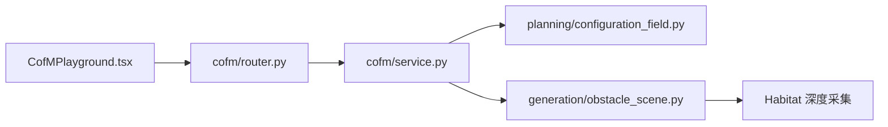

# cof-m Playground 文件导航

整理日期：2026-11-17。当前页面使用几何 teacher，不运行神经网络。

## 页面如何工作

| 文件 | 用途 | 保留原因 |
| --- | --- | --- |
| `app/src/modes/CofMPlayground.tsx` | 场景选择、地图选点、形态滑条、深度与流场展示 | 页面主体 |
| `app/src/modes/registry.ts` | 将后端模式对应到 React 页面 | 页面注册 |
| `app/src/styles.css` | 布局和样式 | 页面显示 |
| `app/openapi.json` | 后端接口快照 | 生成前端类型的依据 |
| `app/src/api/schema.d.ts` | 前端请求/响应类型 | 防止前后端字段不一致 |
| `src/cofl/app/config.py` | 读取场景目录、解释器及输出路径配置 | 服务启动 |
| `src/cofl/app/modes.py` | 注册工作区和模式 | 菜单与功能发现 |
| `src/cofl/app/server.py` | 组装 HTTP 服务、静态页面及共享能力 | 服务入口 |
| `src/cofl/app/cofm/__init__.py` | 导出服务、路由和数据类型 | Python 包入口 |
| `src/cofl/app/cofm/contracts.py` | 定义请求和响应字段 | 页面与后端的数据约定 |
| `src/cofl/app/cofm/router.py` | 接收 HTTP 请求、检查来源、转换错误 | API 入口 |
| `src/cofl/app/cofm/service.py` | 读取场景、验证停泊点、调用 teacher、缓存、导出和采集深度 | 页面业务逻辑 |
| `src/cofl/planning/__init__.py` | 声明规划包 | Python 包结构 |
| `src/cofl/planning/configuration_field.py` | 机体代理、碰撞及扫掠检查、构型图、Dijkstra 和标签 | teacher 算法 |
| `src/cofl/generation/obstacle_scene.py` | 创建柱/墙、导出 GLB、调用 Habitat 获取深度 | 场景和观测 |
| `src/cofl/experiments/habitat_scene_set.py` | 批量生成场景、深度及 Studio 场景目录 | 为页面准备场景 |
| `configs/generation/habitat_depth.yaml` | 独立 Habitat 环境安装配方 | 深度采集环境 |
| `reproduce/test_cofm_studio.py` | 停泊、选点、API、teacher 导出测试 | 验证页面后端 |
| `reproduce/test_configuration_field.py` | 形态约束、扫掠碰撞、可达性和标签测试 | 验证 teacher |
| `reproduce/test_obstacle_scene.py` | 障碍几何、间距和场景格式测试 | 验证场景生成 |
| `README.md` | 项目入口与文档索引 | 使用说明 |
| `docs/cof-m-studio.md` | 启动、操作、退出及排错 | 用户教程 |
| `docs/cof-m-obstacle-scenes.md` | 场景生成和深度采集命令 | 用户教程 |
| `docs/app.md` | Studio 共享服务和其他原有模式说明 | 共享系统参考 |
| `docs/models.md` | 原 CoFL/CoFL-S 网络接口说明 | 原项目参考，与当前 teacher 分开 |

## 调参数的位置

- 场地尺寸、柱墙数量、间距、相机参数：`obstacle_scene.py::SceneConfig`。
- 批量场景种子和划分：`habitat_scene_set.py`。
- 机体尺寸、形态与碰撞：`planning/configuration_field.py::CoupledCrossProxy`。
- 页面 teacher 分辨率、安全裕度、代价和箭头抽样：`service.py::CofMService`。
- 页面布局和交互：`CofMPlayground.tsx`。

## 已删除的独立代码

- `models/cofm.py`、`models/dformer.py`、`models/vendor/dformer.py`：未接入页面的 DFormer 网络及兼容入口。
- `experiments/depth_pipeline.py`、`reproduce/test_depth_dformer.py`：上述网络的独立推理、梯度和 checkpoint 实验及测试。
- `experiments/supervision_geometry.py`：独立几何实验、绘图和报告命令；teacher 测试所需的两个 fixture 函数已移入测试文件。
- `generation/configuration_field.py`：旧导入转发层，调用方直接使用 `planning/configuration_field.py`。

原 CoFL/CoFL-S 以及其他 Studio 工作区暂时保留：共享后端会导入它们，删除需要继续拆分服务依赖。生成场景、深度、teacher 和历史 checkpoint 等本地产物没有删除。

本次以 `01e2738c5b0a92e2d875e5052fc80f3088587fac` 为基准检查后续新增内容。新增的 HTTP 服务拆分、数据契约和规划包均属于 Playground 依赖，继续保留；历史讨论/实验汇总文档及其专用几何实验图片已删除。
